# Stimulus gallery

*Generated from [catalogue.json](catalogue.json) and the stage manifests by `npm run gallery:collection`; do not edit by hand. The catalogue remains the record.*

Linked photographs are shown from their source sites and keep their recorded licences; they may stop displaying if a source link expires. Click an image for its publisher page or full-size file. See [README.md](README.md) for the levels.

## bicycles

Suitable: 20 · raw only: 4 · standardised: 20 · manipulated: 0 · final sets: 1

### Suitable

Rights-verified and visually reviewed, by rank.

<table>
<tr>
<td width="33%" valign="top"> <b>#1</b> White folding bicycle against a wall bicycle · target (member-normal) · Strong base zengfanfu · <a href="https://creativecommons.org/publicdomain/zero/1.0/">CC0 1.0</a> Visual: approved · rights: approved</td>
<td width="33%" valign="top"> <b>#2</b> Blue motor scooter beside a white wall motor-scooter · distractor (non-member) · Strong base Mathias Reding · <a href="https://www.pexels.com/license/">Pexels License</a> Visual: approved · rights: approved</td>
<td width="33%" valign="top"> <b>#3</b> Red bicycle against a grey metal wall bicycle · target (member-normal) · Strong base Marija Zaric · <a href="https://unsplash.com/license">Unsplash License</a> Visual: approved · rights: approved</td>
</tr>
<tr>
<td width="33%" valign="top"> <b>#4</b> Road bicycle leaning against a tree bicycle · target (member-normal) · Strong base Frederick Adegoke Snr. · <a href="https://www.pexels.com/license/">Pexels License</a> Visual: approved · rights: approved</td>
<td width="33%" valign="top"> <b>#5</b> Blue city bicycle beside a red bench bicycle · target (member-normal) · Strong base Christian Stahl · <a href="https://unsplash.com/license">Unsplash License</a> Visual: approved · rights: approved</td>
<td width="33%" valign="top"> <b>#6</b> Skateboard resting on pavement skateboard · distractor (non-member) · Strong base Pict4life · <a href="https://unsplash.com/license">Unsplash License</a> Visual: approved · rights: approved</td>
</tr>
<tr>
<td width="33%" valign="top"> <b>#7</b> Cream bicycle with a rear carrier bicycle · target (member-normal) · Strong base Waldemar Brandt · <a href="https://unsplash.com/license">Unsplash License</a> Visual: approved · rights: approved</td>
<td width="33%" valign="top"> <b>#8</b> Small green bicycle by a brick wall bicycle · target (member-normal) · Strong base Cassie Matias · <a href="https://unsplash.com/license">Unsplash License</a> Visual: approved · rights: approved</td>
<td width="33%" valign="top"> <b>#9</b> Motorcycle parked in front of a brick wall motorcycle · distractor (non-member) · Strong base Kajetan Sumila · <a href="https://unsplash.com/license">Unsplash License</a> Visual: approved · rights: approved</td>
</tr>
<tr>
<td width="33%" valign="top"> <b>#10</b> Bicycle leaning against a metal fence bicycle · target (member-normal) · Good alternative Jan van der Wolf · <a href="https://www.pexels.com/license/">Pexels License</a> Visual: approved · rights: approved</td>
<td width="33%" valign="top"> <b>#11</b> Silver bicycle beside a pastel wall bicycle · target (member-normal) · Good alternative Kuyune · <a href="https://unsplash.com/license">Unsplash License</a> Visual: approved · rights: approved</td>
<td width="33%" valign="top"> <b>#12</b> Red road bicycle by a timber railing bicycle · target (member-normal) · Good alternative Emre Uğurlu · <a href="https://www.pexels.com/license/">Pexels License</a> Visual: approved · rights: approved</td>
</tr>
<tr>
<td width="33%" valign="top"> <b>#13</b> Green city bicycle against a stone wall bicycle · target (member-normal) · Good alternative Ashley Baxter · <a href="https://unsplash.com/license">Unsplash License</a> Visual: approved · rights: approved</td>
<td width="33%" valign="top"> <b>#14</b> Turquoise road bicycle against a wooden fence bicycle · target (member-normal) · Good alternative leep22725 · <a href="https://pixabay.com/service/license-summary/">Pixabay Content License</a> Visual: approved · rights: approved</td>
<td width="33%" valign="top"> <b>#15</b> Red city bicycle against a light wall bicycle · target (member-normal) · Reserve Valentino Sacco · <a href="https://unsplash.com/license">Unsplash License</a> Visual: approved · rights: approved</td>
</tr>
<tr>
<td width="33%" valign="top"> <b>#16</b> Blue bicycle with a yellow front fork bicycle · target (member-normal) · Reserve Matheus Bertelli · <a href="https://www.pexels.com/license/">Pexels License</a> Visual: approved · rights: approved</td>
<td width="33%" valign="top"> <b>#17</b> City bicycle at a worn street-corner wall bicycle · target (member-normal) · Good alternative Maria Orlova · <a href="https://www.pexels.com/license/">Pexels License</a> Visual: approved · rights: approved</td>
<td width="33%" valign="top"> <b>#18</b> Silver city bicycle against a weathered wall bicycle · target (member-normal) · Reserve Lorenza Magnaghi · <a href="https://www.pexels.com/license/">Pexels License</a> Visual: approved · rights: approved</td>
</tr>
<tr>
<td width="33%" valign="top"> <b>#19</b> Orange road bicycle against a wire fence bicycle · target (member-normal) · Reserve Travel with Lenses · <a href="https://www.pexels.com/license/">Pexels License</a> Visual: approved · rights: approved</td>
<td width="33%" valign="top"> <b>#20</b> Small red microcar under a leafy tree car · distractor (non-member) · Reserve Berna · <a href="https://www.pexels.com/license/">Pexels License</a> Visual: approved · rights: approved</td>
</tr>
</table>

### Raw only

Linked candidates not (yet) promoted to suitable, with their original rank.

<table>
<tr>
<td width="33%" valign="top"> <b>Original #10</b> Black folding bicycle beside a drainpipe bicycle · target (member-normal) · Good alternative Zhanna Filimonenko · <a href="https://www.pexels.com/license/">Pexels License</a> Visual: pending · rights: pending 

Unresolved (1)
Excluded from the verified selection: original publisher page could not be conclusively verified after source searches; replaced by a verified alternative. This is unresolved evidence, not a finding of infringement.
</td>
<td width="33%" valign="top"> <b>Original #11</b> Red-and-white bicycle against a pale wall bicycle · target (member-normal) · Good alternative Stefan · <a href="https://www.pexels.com/license/">Pexels License</a> Visual: pending · rights: pending 

Unresolved (1)
Excluded from the verified selection: original publisher page could not be conclusively verified after source searches; replaced by a verified alternative. This is unresolved evidence, not a finding of infringement.
</td>
<td width="33%" valign="top"> <b>Original #16</b> Red bicycle beside a stone building bicycle · target (member-normal) · Good alternative Stefan · <a href="https://www.pexels.com/license/">Pexels License</a> Visual: pending · rights: pending 

Unresolved (1)
Excluded from the verified selection: original publisher page could not be conclusively verified after source searches; replaced by a verified alternative. This is unresolved evidence, not a finding of infringement.
</td>
</tr>
<tr>
<td width="33%" valign="top"> <b>Original #20</b> Mint-coloured microcar outside a café car · distractor (non-member) · Reserve Berat BAKI · <a href="https://www.pexels.com/license/">Pexels License</a> Visual: pending · rights: pending 

Unresolved (1)
Excluded from the verified selection: original publisher page could not be conclusively verified after source searches; replaced by a verified alternative. This is unresolved evidence, not a finding of infringement.
</td>
</tr>
</table>

### Standardised

<table>
<tr>
<td width="33%" valign="top"><a href="standardized/bicycles/photo-019e294a-a808-7bd3-8b64-191398afb207-standardized-v1.webp">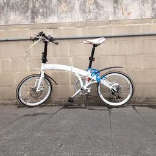</a> <b>#1</b> White folding bicycle against a wall bicycle · target (member-normal) · Strong base zengfanfu · <a href="https://creativecommons.org/publicdomain/zero/1.0/">CC0 1.0</a> Visual: approved · rights: approved</td>
<td width="33%" valign="top"> <b>#2</b> Blue motor scooter beside a white wall motor-scooter · distractor (non-member) · Strong base Mathias Reding · <a href="https://www.pexels.com/license/">Pexels License</a> Visual: approved · rights: approved</td>
<td width="33%" valign="top"><a href="standardized/bicycles/photo-019e2922-adab-744d-b31d-127e879330c3-standardized-v1.webp">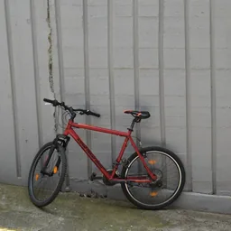</a> <b>#3</b> Red bicycle against a grey metal wall bicycle · target (member-normal) · Strong base Marija Zaric · <a href="https://unsplash.com/license">Unsplash License</a> Visual: approved · rights: approved</td>
</tr>
<tr>
<td width="33%" valign="top"><a href="standardized/bicycles/photo-019e1626-f1ef-7ffc-9319-08fb96ff3414-standardized-v1.webp">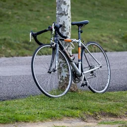</a> <b>#4</b> Road bicycle leaning against a tree bicycle · target (member-normal) · Strong base Frederick Adegoke Snr. · <a href="https://www.pexels.com/license/">Pexels License</a> Visual: approved · rights: approved</td>
<td width="33%" valign="top"><a href="standardized/bicycles/photo-019e1dda-7a82-7950-8d92-51b335fed43a-standardized-v1.webp">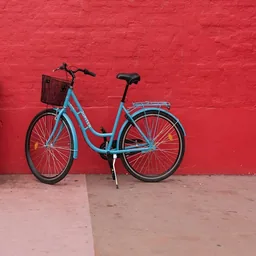</a> <b>#5</b> Blue city bicycle beside a red bench bicycle · target (member-normal) · Strong base Christian Stahl · <a href="https://unsplash.com/license">Unsplash License</a> Visual: approved · rights: approved</td>
<td width="33%" valign="top"> <b>#6</b> Skateboard resting on pavement skateboard · distractor (non-member) · Strong base Pict4life · <a href="https://unsplash.com/license">Unsplash License</a> Visual: approved · rights: approved</td>
</tr>
<tr>
<td width="33%" valign="top"> <b>#7</b> Cream bicycle with a rear carrier bicycle · target (member-normal) · Strong base Waldemar Brandt · <a href="https://unsplash.com/license">Unsplash License</a> Visual: approved · rights: approved</td>
<td width="33%" valign="top"><a href="standardized/bicycles/photo-019e21a6-ec6f-71b4-9a8b-9c0c1fd6e84e-standardized-v1.webp">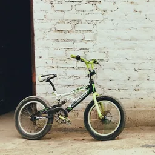</a> <b>#8</b> Small green bicycle by a brick wall bicycle · target (member-normal) · Strong base Cassie Matias · <a href="https://unsplash.com/license">Unsplash License</a> Visual: approved · rights: approved</td>
<td width="33%" valign="top"><a href="standardized/bicycles/photo-019e23a6-5d30-793b-bd37-6789b6499899-standardized-v1.webp">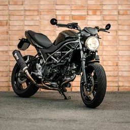</a> <b>#9</b> Motorcycle parked in front of a brick wall motorcycle · distractor (non-member) · Strong base Kajetan Sumila · <a href="https://unsplash.com/license">Unsplash License</a> Visual: approved · rights: approved</td>
</tr>
<tr>
<td width="33%" valign="top"><a href="standardized/bicycles/photo-019e144a-b43a-738a-8bc8-a9756e805dba-standardized-v1.webp">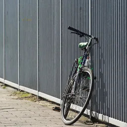</a> <b>#10</b> Bicycle leaning against a metal fence bicycle · target (member-normal) · Good alternative Jan van der Wolf · <a href="https://www.pexels.com/license/">Pexels License</a> Visual: approved · rights: approved</td>
<td width="33%" valign="top"><a href="standardized/bicycles/photo-019e2732-b457-73b7-9026-14b72e9692ba-standardized-v1.webp">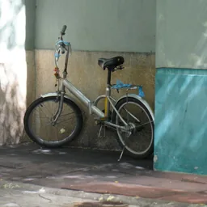</a> <b>#11</b> Silver bicycle beside a pastel wall bicycle · target (member-normal) · Good alternative Kuyune · <a href="https://unsplash.com/license">Unsplash License</a> Visual: approved · rights: approved</td>
<td width="33%" valign="top"><a href="standardized/bicycles/photo-019e1bc3-5b48-75d1-8ef8-8191e5a7e654-standardized-v1.webp">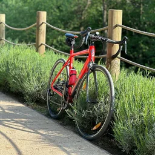</a> <b>#12</b> Red road bicycle by a timber railing bicycle · target (member-normal) · Good alternative Emre Uğurlu · <a href="https://www.pexels.com/license/">Pexels License</a> Visual: approved · rights: approved</td>
</tr>
<tr>
<td width="33%" valign="top"><a href="standardized/bicycles/photo-019e21c4-06ac-7d87-9a69-da4691fb9ad9-standardized-v1.webp">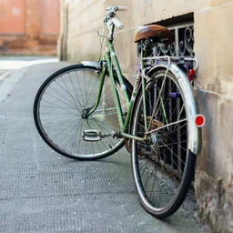</a> <b>#13</b> Green city bicycle against a stone wall bicycle · target (member-normal) · Good alternative Ashley Baxter · <a href="https://unsplash.com/license">Unsplash License</a> Visual: approved · rights: approved</td>
<td width="33%" valign="top"><a href="standardized/bicycles/photo-019e20ab-ec8b-7f7e-aa03-90e0eb46d9f2-standardized-v1.webp">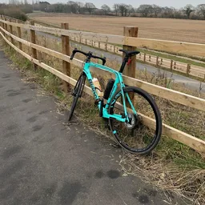</a> <b>#14</b> Turquoise road bicycle against a wooden fence bicycle · target (member-normal) · Good alternative leep22725 · <a href="https://pixabay.com/service/license-summary/">Pixabay Content License</a> Visual: approved · rights: approved</td>
<td width="33%" valign="top"> <b>#15</b> Red city bicycle against a light wall bicycle · target (member-normal) · Reserve Valentino Sacco · <a href="https://unsplash.com/license">Unsplash License</a> Visual: approved · rights: approved</td>
</tr>
<tr>
<td width="33%" valign="top"><a href="standardized/bicycles/photo-019e1970-796f-731f-90ce-232d86c4eb1e-standardized-v1.webp">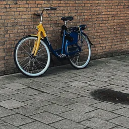</a> <b>#16</b> Blue bicycle with a yellow front fork bicycle · target (member-normal) · Reserve Matheus Bertelli · <a href="https://www.pexels.com/license/">Pexels License</a> Visual: approved · rights: approved</td>
<td width="33%" valign="top"><a href="standardized/bicycles/photo-019e147c-0ae7-7793-8c79-b26344f176fb-standardized-v1.webp">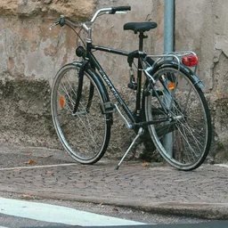</a> <b>#17</b> City bicycle at a worn street-corner wall bicycle · target (member-normal) · Good alternative Maria Orlova · <a href="https://www.pexels.com/license/">Pexels License</a> Visual: approved · rights: approved</td>
<td width="33%" valign="top"><a href="standardized/bicycles/photo-019e0fed-2b99-7df3-9285-402da53ce583-standardized-v1.webp">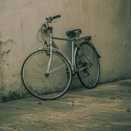</a> <b>#18</b> Silver city bicycle against a weathered wall bicycle · target (member-normal) · Reserve Lorenza Magnaghi · <a href="https://www.pexels.com/license/">Pexels License</a> Visual: approved · rights: approved</td>
</tr>
<tr>
<td width="33%" valign="top"><a href="standardized/bicycles/photo-019e1476-12d8-7676-86f1-09354d8187c1-standardized-v1.webp">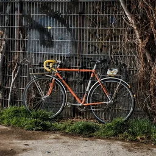</a> <b>#19</b> Orange road bicycle against a wire fence bicycle · target (member-normal) · Reserve Travel with Lenses · <a href="https://www.pexels.com/license/">Pexels License</a> Visual: approved · rights: approved</td>
<td width="33%" valign="top"><a href="standardized/bicycles/photo-019e1c8c-e6d3-7bba-a08c-af0141e7f27b-standardized-v1.webp">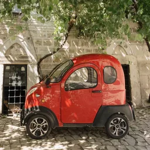</a> <b>#20</b> Small red microcar under a leafy tree car · distractor (non-member) · Reserve Berna · <a href="https://www.pexels.com/license/">Pexels License</a> Visual: approved · rights: approved</td>
</tr>
</table>

### Manipulated

None yet.

### Final sets

#### G01@1 — legacy-import

“Select all images containing a bicycle.” ([manifest](final/bicycles/G01/1/manifest.json))

<table>
<tr>
<td width="33%" valign="top"> <b>G01-T1 ✓</b> A black city bicycle leaning against a green wooden door on a cobbled street bicycle · target (member-normal) · Existing published tile Department of Human Verification · <a href="https://www.gnu.org/licenses/gpl-3.0.html">GPL-3.0-or-later</a> Visual: inherited · rights: inherited 

Unresolved (1)
Historical intermediate files and review timestamps are unavailable; they have not been fabricated.
</td>
<td width="33%" valign="top"> <b>G01-T2 ✓</b> A red bicycle with a wicker basket parked against a brick wall bicycle · target (member-normal) · Existing published tile Department of Human Verification · <a href="https://www.gnu.org/licenses/gpl-3.0.html">GPL-3.0-or-later</a> Visual: inherited · rights: inherited 

Unresolved (1)
Historical intermediate files and review timestamps are unavailable; they have not been fabricated.
</td>
<td width="33%" valign="top"> <b>G01-T3 ✓</b> A blue road bicycle on an empty country road bicycle · target (member-normal) · Existing published tile Department of Human Verification · <a href="https://www.gnu.org/licenses/gpl-3.0.html">GPL-3.0-or-later</a> Visual: inherited · rights: inherited 

Unresolved (1)
Historical intermediate files and review timestamps are unavailable; they have not been fabricated.
</td>
</tr>
<tr>
<td width="33%" valign="top"> <b>G01-T4 ✓</b> A small yellow child's bicycle with training wheels on a lawn bicycle · target (member-normal) · Existing published tile Department of Human Verification · <a href="https://www.gnu.org/licenses/gpl-3.0.html">GPL-3.0-or-later</a> Visual: inherited · rights: inherited 

Unresolved (1)
Historical intermediate files and review timestamps are unavailable; they have not been fabricated.
</td>
<td width="33%" valign="top"> <b>G01-T5</b> A red vintage motor scooter parked on a street motor-scooter · distractor (non-member) · Existing published tile Department of Human Verification · <a href="https://www.gnu.org/licenses/gpl-3.0.html">GPL-3.0-or-later</a> Visual: inherited · rights: inherited 

Unresolved (1)
Historical intermediate files and review timestamps are unavailable; they have not been fabricated.
</td>
<td width="33%" valign="top"> <b>G01-T6</b> A blue motorcycle parked on a cobbled square motorcycle · distractor (non-member) · Existing published tile Department of Human Verification · <a href="https://www.gnu.org/licenses/gpl-3.0.html">GPL-3.0-or-later</a> Visual: inherited · rights: inherited 

Unresolved (1)
Historical intermediate files and review timestamps are unavailable; they have not been fabricated.
</td>
</tr>
<tr>
<td width="33%" valign="top"> <b>G01-T7</b> A child's kick scooter on a pavement kick-scooter · distractor (non-member) · Existing published tile Department of Human Verification · <a href="https://www.gnu.org/licenses/gpl-3.0.html">GPL-3.0-or-later</a> Visual: inherited · rights: inherited 

Unresolved (1)
Historical intermediate files and review timestamps are unavailable; they have not been fabricated.
</td>
<td width="33%" valign="top"> <b>G01-T8</b> A skateboard on paving stones skateboard · distractor (non-member) · Existing published tile Department of Human Verification · <a href="https://www.gnu.org/licenses/gpl-3.0.html">GPL-3.0-or-later</a> Visual: inherited · rights: inherited 

Unresolved (1)
Historical intermediate files and review timestamps are unavailable; they have not been fabricated.
</td>
<td width="33%" valign="top"> <b>G01-T9</b> A small white vintage car parked on a street car · distractor (non-member) · Existing published tile Department of Human Verification · <a href="https://www.gnu.org/licenses/gpl-3.0.html">GPL-3.0-or-later</a> Visual: inherited · rights: inherited 

Unresolved (1)
Historical intermediate files and review timestamps are unavailable; they have not been fabricated.
</td>
</tr>
</table>
