# Stimulus gallery

*Generated from [catalogue.json](catalogue.json) and the stage manifests by `npm run gallery:collection`; do not edit by hand. The catalogue remains the record.*

Linked photographs are shown from their source sites and keep their recorded licences; they may stop displaying if a source link expires. Click an image for its publisher page or full-size file. See [README.md](README.md) for the levels.

## bicycles

Suitable: 34 · awaiting review: 0 · rejected: 21 · standardised: 36 · manipulated: 2 · final sets: 0

### Suitable

Rights-verified and visually reviewed, by rank.

<table>
<tr>
<td width="33%" valign="top"> <b>#1</b> Black track bicycle against a white wall bicycle · photograph · target (member-normal) · Meets target clarity Alonso Talbert · <a href="https://unsplash.com/license">Unsplash License</a> Visual: approved · rights: approved</td>
<td width="33%" valign="top"> <b>#2</b> White road bicycle against a teal wooden wall bicycle · photograph · target (member-normal) · Meets target clarity Carl Nenzen Loven · <a href="https://unsplash.com/license">Unsplash License</a> Visual: approved · rights: approved</td>
<td width="33%" valign="top"> <b>#3</b> Blue motor scooter beside a white wall motor-scooter · photograph · distractor (non-member) · Meets target clarity Mathias Reding · <a href="https://www.pexels.com/license/">Pexels License</a> Visual: approved · rights: approved</td>
</tr>
<tr>
<td width="33%" valign="top"> <b>#4</b> Pink step-through bicycle before dark foliage bicycle · photograph · target (member-normal) · Meets target clarity Kadir Kvs · <a href="https://unsplash.com/license">Unsplash License</a> Visual: approved · rights: approved</td>
<td width="33%" valign="top"> <b>#5</b> Light blue bicycle with a wooden crate against a white wall bicycle · photograph · target (member-normal) · Meets target clarity Kris Tian · <a href="https://unsplash.com/license">Unsplash License</a> Visual: approved · rights: approved</td>
<td width="33%" valign="top"> <b>#6</b> Red city bicycle against a light wall bicycle · photograph · target (member-normal) · Meets target clarity Valentino Sacco · <a href="https://unsplash.com/license">Unsplash License</a> Visual: approved · rights: approved</td>
</tr>
<tr>
<td width="33%" valign="top"> <b>#7</b> Lavender bicycle with orange tyres against a white brick wall bicycle · photograph · target (member-normal) · Meets target clarity Tiffany Nutt · <a href="https://unsplash.com/license">Unsplash License</a> Visual: approved · rights: approved</td>
<td width="33%" valign="top"> <b>#8</b> Black cruiser motorcycle against a stone building motorcycle · photograph · distractor (non-member) · Meets target clarity Iván Antonio · <a href="https://unsplash.com/license">Unsplash License</a> Visual: approved · rights: approved</td>
<td width="33%" valign="top"> <b>#9</b> White road bicycle against black and red facade panels bicycle · photograph · target (member-normal) · Meets target clarity streetwaw_ · <a href="https://unsplash.com/license">Unsplash License</a> Visual: approved · rights: approved</td>
</tr>
<tr>
<td width="33%" valign="top"> <b>#10</b> Cream bicycle with a rear carrier bicycle · photograph · target (member-normal) · Meets target clarity Waldemar Brandt · <a href="https://unsplash.com/license">Unsplash License</a> Visual: approved · rights: approved</td>
<td width="33%" valign="top"> <b>#11</b> Black city bicycle against a yellow house bicycle · photograph · target (member-normal) · Meets target clarity Razvan Mirel · <a href="https://unsplash.com/license">Unsplash License</a> Visual: approved · rights: approved</td>
<td width="33%" valign="top"> <b>#12</b> Skateboard resting on pavement skateboard · photograph · distractor (non-member) · Meets target clarity Pict4life · <a href="https://unsplash.com/license">Unsplash License</a> Visual: approved · rights: approved</td>
</tr>
<tr>
<td width="33%" valign="top"> <b>#13</b> Orange and teal mountain bike on grass by driftwood bicycle · photograph · target (member-normal) · Meets target clarity Yasin Aydın · <a href="https://www.pexels.com/license/">Pexels License</a> Visual: approved · rights: approved</td>
<td width="33%" valign="top"> <b>#14</b> Yellow cruiser bicycle with a flower basket against a wooden door bicycle · photograph · target (member-normal) · Meets target clarity Mehmet Guzel · <a href="https://unsplash.com/license">Unsplash License</a> Visual: approved · rights: approved</td>
<td width="33%" valign="top"> <b>#15</b> Copper city bicycle leaning against a street pole bicycle · photograph · target (member-normal) · Meets target clarity Volker Thimm · <a href="https://www.pexels.com/license/">Pexels License</a> Visual: approved · rights: approved</td>
</tr>
<tr>
<td width="33%" valign="top"> <b>#16</b> Small red car parked before a hedge car · photograph · distractor (non-member) · Meets target clarity CrowN · <a href="https://unsplash.com/license">Unsplash License</a> Visual: approved · rights: approved</td>
<td width="33%" valign="top"> <b>#17</b> Red vintage bicycle against a blue clapboard wall bicycle · photograph · target (member-normal) · Meets target clarity Jason Gooljar · <a href="https://unsplash.com/license">Unsplash License</a> Visual: approved · rights: approved</td>
<td width="33%" valign="top"> <b>#18</b> Turquoise bicycle with a crate against a dune fence bicycle · photograph · target (member-normal) · Meets target clarity Soumia Sol · <a href="https://www.pexels.com/license/">Pexels License</a> Visual: approved · rights: approved</td>
</tr>
<tr>
<td width="33%" valign="top"> <b>#19</b> Teal city bicycle against a canal-bridge railing bicycle · photograph · target (member-normal) · Meets target clarity Dmitrii E. · <a href="https://unsplash.com/license">Unsplash License</a> Visual: approved · rights: approved</td>
<td width="33%" valign="top"> <b>#20</b> Pale green bicycle with a basket beside a wooden door bicycle · photograph · target (member-normal) · Meets target clarity Thomas P · <a href="https://www.pexels.com/license/">Pexels License</a> Visual: approved · rights: approved</td>
<td width="33%" valign="top"> <b>#21</b> Black roadster bicycle with a front basket against a white wall bicycle · photograph · target (member-normal) · Meets target clarity Naura Ra · <a href="https://unsplash.com/license">Unsplash License</a> Visual: approved · rights: approved</td>
</tr>
<tr>
<td width="33%" valign="top"> <b>#22</b> Navy road bicycle against a two-tone wall bicycle · photograph · target (member-normal) · Meets target clarity Zoltan Tasi · <a href="https://unsplash.com/license">Unsplash License</a> Visual: approved · rights: approved</td>
<td width="33%" valign="top"> <b>#23</b> Copper fixed-gear bicycle against a white wall bicycle · photograph · target (member-normal) · Meets target clarity Markus Spiske · <a href="https://unsplash.com/license">Unsplash License</a> Visual: approved · rights: approved</td>
<td width="33%" valign="top"> <b>#24</b> Black city bicycle with a basket against a grey wall bicycle · photograph · target (member-normal) · Meets target clarity Abhishek Ravi · <a href="https://unsplash.com/license">Unsplash License</a> Visual: approved · rights: approved</td>
</tr>
<tr>
<td width="33%" valign="top"> <b>#25</b> Black fixed-gear bicycle against a grey concrete wall bicycle · photograph · target (member-normal) · Meets target clarity Howard Bouchevereau · <a href="https://unsplash.com/license">Unsplash License</a> Visual: approved · rights: approved</td>
<td width="33%" valign="top"> <b>#26</b> Light-blue touring bicycle against a dry hillside bicycle · photograph · target (member-normal) · Meets target clarity cyclotourist · <a href="https://creativecommons.org/licenses/by-nc/2.0/">CC BY-NC 2.0</a> Visual: approved · rights: approved</td>
<td width="33%" valign="top"> <b>#27</b> Copper-orange custom cruiser bicycle on open asphalt bicycle · photograph · target (member-normal) · Meets target clarity Sidral Mundet · <a href="https://unsplash.com/license">Unsplash License</a> Visual: approved · rights: approved 

Unresolved (1)
Custom low-rider cruiser with long swept handlebars and a stretched frame: clearly a bicycle, but a less typical shape; confirm it reads as a normal member rather than a borderline item when composing a set.
</td>
</tr>
<tr>
<td width="33%" valign="top"> <b>#28</b> Yellow roadster bicycle between lavender rows bicycle · photograph · target (member-normal) · Meets target clarity Gunay Topaloglu · <a href="https://unsplash.com/license">Unsplash License</a> Visual: approved · rights: approved 

Unresolved (1)
A few out-of-focus lavender stems at the lower left touch the front tyre; they do not hide any defining part. Reject if the owner reads this as an obstruction.
</td>
<td width="33%" valign="top"> <b>#29</b> Silver-beige city bicycle with a basket by a lavender border bicycle · photograph · target (member-normal) · Meets target clarity Teodor Buhl · <a href="https://www.pexels.com/license/">Pexels License</a> Visual: approved · rights: approved 

Unresolved (1)
The front tyre comes within about 1–2% of the lower crop edge because the preview leaves no more room; nothing is cut.
</td>
<td width="33%" valign="top"> <b>#30</b> Black hybrid bicycle on a tree-lined park road bicycle · photograph · target (member-normal) · Meets target clarity Ionut Zamfir · <a href="https://unsplash.com/license">Unsplash License</a> Visual: approved · rights: approved</td>
</tr>
<tr>
<td width="33%" valign="top"> <b>#31</b> Black vintage roadster bicycle on a park lawn bicycle · photograph · target (member-normal) · Meets target clarity Alex Plesovskich · <a href="https://unsplash.com/license">Unsplash License</a> Visual: approved · rights: approved 

Unresolved (1)
The dark frame is partly seen against green grass; it remains clear at 128 px because the frame is much darker than the lawn.
</td>
<td width="33%" valign="top"> <b>#32</b> Dark grey recumbent exercise bike on a pale rooftop terrace exercise-bike · photograph · borderline (member-debatable) · Meets target clarity Intenza Fitness · <a href="https://unsplash.com/license">Unsplash License</a> Visual: approved · rights: approved 

Unresolved (2)
The photographer is the equipment maker; small product logos are visible and no endorsement is implied.  A recumbent model on a terrace rather than an upright bike in a gym; it still reads at once as a stationary exercise bike.
</td>
<td width="33%" valign="top"> <b>#33</b> Vintage dappled rocking horse on a wooden floor rocking-horse · photograph · distractor (non-member) · Meets target clarity Georgii Eletskikh · <a href="https://unsplash.com/license">Unsplash License</a> Visual: approved · rights: approved</td>
</tr>
<tr>
<td width="33%" valign="top"> <b>#34</b> Turquoise electric kick scooter by a waterfront railing kick-scooter · photograph · distractor (non-member) · Meets target clarity Şahin Sezer Dinçer · <a href="https://www.pexels.com/license/">Pexels License</a> Visual: approved · rights: approved 

Unresolved (1)
A shared electric kick scooter; the railing passes behind it, not in front.
</td>
</tr>
</table>

Rejected photographs (21), not shown
<ul><li><a href="https://pixabay.com/photos/bike-riverside-guangzhou-lock-1128840/">White folding bicycle against a wall</a>: Only nearly meets the target clarity standard: about 72% of the crop, white frame against a pale wall, empty foreground.</li><li><a href="https://unsplash.com/photos/red-and-black-bicycle-leaning-on-white-metal-fence-05w655MmFx8">Red bicycle against a grey metal wall</a>: Only nearly meets the target clarity standard: about 67% of the crop, the lower limit.</li><li><a href="https://www.pexels.com/photo/road-bicycle-by-tree-by-road-14682786/">Road bicycle leaning against a tree</a>: Below the target clarity standard: the tree trunk overlaps the frame, the silver frame has low contrast against the grey road, and the bicycle spans only about 62% of the crop.</li><li><a href="https://unsplash.com/photos/blue-step-through-bicycle-park-beside-of-red-bench-xmGkzY--Fgg">Blue city bicycle beside a red bench</a>: Below the target clarity standard: the bicycle spans only about 62% of the crop above a large empty foreground; the 600 px crop cannot be tightened without upscaling.</li><li><a href="https://unsplash.com/photos/black-and-green-full-suspension-bike-1lE8ivHMQN8">Small green bicycle by a brick wall</a>: Only nearly meets the target clarity standard: about 70% of the crop, with a dark doorway at the edge.</li><li><a href="https://unsplash.com/photos/a-motorcycle-parked-in-front-of-a-brick-wall-xzEbZjbS4cA">Motorcycle parked in front of a brick wall</a>: Only nearly meets the target clarity standard: front three-quarter view of about 45 degrees, beyond the 30-degree limit.</li><li><a href="https://thumb.pexafy.com/019e2013-2936-7e0f-be55-db92f55205ac/1280w.jpg?s=1f6f3afccc0b02a7">Black folding bicycle beside a drainpipe</a>: Below the target clarity standard: a drainpipe crosses the bicycle, and the black frame has little contrast against the dark ground.</li><li><a href="https://thumb.pexafy.com/019e16d6-9e99-74b9-b724-edfbe7a4c8b9/1280w.jpg?s=8a5543a2b20c6bfc">Red-and-white bicycle against a pale wall</a>: Below the target clarity standard: close, steep front three-quarter view.</li><li><a href="https://www.pexels.com/photo/bike-attached-to-a-fence-12322815">Bicycle leaning against a metal fence</a>: Below the target clarity standard: near-frontal steep view; the dark bicycle has little contrast against the dark ribbed fence.</li><li><a href="https://unsplash.com/photos/a-bicycle-is-parked-next-to-a-building-2baxeyMG-eM">Silver bicycle beside a pastel wall</a>: Below the target clarity standard: silver bicycle with low contrast against a grey and pastel wall, partly shaded, off-centre and about 65% of the crop.</li><li><a href="https://www.pexels.com/photo/a-bicycle-standing-on-the-side-of-the-pavement-19172412/">Red road bicycle by a timber railing</a>: Below the target clarity standard: steep three-quarter view, with the railing and foliage behind the frame.</li><li><a href="https://unsplash.com/photos/green-female-beach-cruiser-bike-leaning-on-wall-GmMTa8Mjngg">Green city bicycle against a stone wall</a>: Below the target clarity standard: close, steeply oblique rear view that foreshortens the bicycle.</li><li><a href="https://thumb.pexafy.com/019e144a-c76c-7a96-b721-6646821bfd2e/1280w.jpg?s=8fed9a0395c74d36">Red bicycle beside a stone building</a>: Only nearly meets the target clarity standard: rear three-quarter view of about 45 degrees, beyond the 30-degree limit.</li><li><a href="https://pixabay.com/photos/cycling-motivation-like-thinking-6094699/">Turquoise road bicycle against a wooden fence</a>: Below the target clarity standard: the bicycle spans only about 47% of the crop, in a three-quarter view against fence and field detail.</li><li><a href="https://www.pexels.com/photo/bicycle-leaning-on-a-brick-wall-18999320">Blue bicycle with a yellow front fork</a>: Below the target clarity standard: the bicycle spans only about 60% of the crop above a large paving foreground.</li><li><a href="https://www.pexels.com/photo/vintage-vehicle-next-to-a-cafeteria-13503005">Mint-coloured microcar outside a café</a>: Only nearly meets the target clarity standard: busy cafe frontage behind the car, about 70% of the crop.</li><li><a href="https://www.pexels.com/photo/vintage-bicycle-resting-against-weathered-wall-36095859/">Silver city bicycle against a weathered wall</a>: Below the target clarity standard: silver bicycle with low contrast against a grey-olive wall, about 62% of the crop.</li><li><a href="https://www.pexels.com/photo/bicycle-on-pavement-near-wall-4946807/">City bicycle at a worn street-corner wall</a>: Only nearly meets the target clarity standard: about 72% of the crop, with a pole close behind the rear wheel.</li><li><a href="https://www.pexels.com/photo/bike-parked-near-wall-25849065/">Orange road bicycle against a wire fence</a>: Below the target clarity standard: thin frame parts and spokes are lost against the wire mesh and graffiti behind.</li><li><a href="https://www.pexels.com/photo/a-small-red-car-parked-in-front-of-a-tree-27851602/">Small red microcar under a leafy tree</a>: Only nearly meets the target clarity standard: the car touches the right edge of the crop, in an angled front view.</li><li><a href="https://unsplash.com/photos/black-bike-beside-wall-bF4Ab0gpaPs">Green bicycle against an ivy-covered white wall</a>: Below the target clarity standard (owner's review, 27 October 2026): the green frame has too little figure-ground contrast against the green and autumn-coloured ivy behind it.</li></ul>

### Standardised

<table>
<tr>
<td width="33%" valign="top"> <b>#1</b> Black track bicycle against a white wall bicycle · photograph · target (member-normal) · Meets target clarity Alonso Talbert · <a href="https://unsplash.com/license">Unsplash License</a> Visual: approved · rights: approved</td>
<td width="33%" valign="top"> <b>#2</b> Blue motor scooter beside a white wall motor-scooter · photograph · distractor (non-member) · Meets target clarity Mathias Reding · <a href="https://www.pexels.com/license/">Pexels License</a> Visual: approved · rights: approved</td>
<td width="33%" valign="top"> <b>#2</b> White road bicycle against a teal wooden wall bicycle · photograph · target (member-normal) · Meets target clarity Carl Nenzen Loven · <a href="https://unsplash.com/license">Unsplash License</a> Visual: approved · rights: approved</td>
</tr>
<tr>
<td width="33%" valign="top"> <b>#4</b> Pink step-through bicycle before dark foliage bicycle · photograph · target (member-normal) · Meets target clarity Kadir Kvs · <a href="https://unsplash.com/license">Unsplash License</a> Visual: approved · rights: approved</td>
<td width="33%" valign="top"> <b>#5</b> Light blue bicycle with a wooden crate against a white wall bicycle · photograph · target (member-normal) · Meets target clarity Kris Tian · <a href="https://unsplash.com/license">Unsplash License</a> Visual: approved · rights: approved</td>
<td width="33%" valign="top"> <b>#6</b> Skateboard resting on pavement skateboard · photograph · distractor (non-member) · Meets target clarity Pict4life · <a href="https://unsplash.com/license">Unsplash License</a> Visual: approved · rights: approved</td>
</tr>
<tr>
<td width="33%" valign="top"> <b>#7</b> Cream bicycle with a rear carrier bicycle · photograph · target (member-normal) · Meets target clarity Waldemar Brandt · <a href="https://unsplash.com/license">Unsplash License</a> Visual: approved · rights: approved</td>
<td width="33%" valign="top"> <b>#7</b> Lavender bicycle with orange tyres against a white brick wall bicycle · photograph · target (member-normal) · Meets target clarity Tiffany Nutt · <a href="https://unsplash.com/license">Unsplash License</a> Visual: approved · rights: approved</td>
<td width="33%" valign="top"> <b>#8</b> Black cruiser motorcycle against a stone building motorcycle · photograph · distractor (non-member) · Meets target clarity Iván Antonio · <a href="https://unsplash.com/license">Unsplash License</a> Visual: approved · rights: approved</td>
</tr>
<tr>
<td width="33%" valign="top"> <b>#9</b> White road bicycle against black and red facade panels bicycle · photograph · target (member-normal) · Meets target clarity streetwaw_ · <a href="https://unsplash.com/license">Unsplash License</a> Visual: approved · rights: approved</td>
<td width="33%" valign="top"> <b>#11</b> Black city bicycle against a yellow house bicycle · photograph · target (member-normal) · Meets target clarity Razvan Mirel · <a href="https://unsplash.com/license">Unsplash License</a> Visual: approved · rights: approved</td>
<td width="33%" valign="top"> <b>#13</b> Orange and teal mountain bike on grass by driftwood bicycle · photograph · target (member-normal) · Meets target clarity Yasin Aydın · <a href="https://www.pexels.com/license/">Pexels License</a> Visual: approved · rights: approved</td>
</tr>
<tr>
<td width="33%" valign="top"> <b>#14</b> Yellow cruiser bicycle with a flower basket against a wooden door bicycle · photograph · target (member-normal) · Meets target clarity Mehmet Guzel · <a href="https://unsplash.com/license">Unsplash License</a> Visual: approved · rights: approved</td>
<td width="33%" valign="top"> <b>#15</b> Red city bicycle against a light wall bicycle · photograph · target (member-normal) · Meets target clarity Valentino Sacco · <a href="https://unsplash.com/license">Unsplash License</a> Visual: approved · rights: approved</td>
<td width="33%" valign="top"> <b>#15</b> Copper city bicycle leaning against a street pole bicycle · photograph · target (member-normal) · Meets target clarity Volker Thimm · <a href="https://www.pexels.com/license/">Pexels License</a> Visual: approved · rights: approved</td>
</tr>
<tr>
<td width="33%" valign="top"> <b>#16</b> Small red car parked before a hedge car · photograph · distractor (non-member) · Meets target clarity CrowN · <a href="https://unsplash.com/license">Unsplash License</a> Visual: approved · rights: approved</td>
<td width="33%" valign="top"> <b>#17</b> Red vintage bicycle against a blue clapboard wall bicycle · photograph · target (member-normal) · Meets target clarity Jason Gooljar · <a href="https://unsplash.com/license">Unsplash License</a> Visual: approved · rights: approved</td>
<td width="33%" valign="top"> <b>#18</b> Turquoise bicycle with a crate against a dune fence bicycle · photograph · target (member-normal) · Meets target clarity Soumia Sol · <a href="https://www.pexels.com/license/">Pexels License</a> Visual: approved · rights: approved</td>
</tr>
<tr>
<td width="33%" valign="top"> <b>#19</b> Teal city bicycle against a canal-bridge railing bicycle · photograph · target (member-normal) · Meets target clarity Dmitrii E. · <a href="https://unsplash.com/license">Unsplash License</a> Visual: approved · rights: approved</td>
<td width="33%" valign="top"> <b>#20</b> Pale green bicycle with a basket beside a wooden door bicycle · photograph · target (member-normal) · Meets target clarity Thomas P · <a href="https://www.pexels.com/license/">Pexels License</a> Visual: approved · rights: approved</td>
<td width="33%" valign="top"> <b>#21</b> Black roadster bicycle with a front basket against a white wall bicycle · photograph · target (member-normal) · Meets target clarity Naura Ra · <a href="https://unsplash.com/license">Unsplash License</a> Visual: approved · rights: approved</td>
</tr>
<tr>
<td width="33%" valign="top"> <b>#22</b> Navy road bicycle against a two-tone wall bicycle · photograph · target (member-normal) · Meets target clarity Zoltan Tasi · <a href="https://unsplash.com/license">Unsplash License</a> Visual: approved · rights: approved</td>
<td width="33%" valign="top"> <b>#23</b> Copper fixed-gear bicycle against a white wall bicycle · photograph · target (member-normal) · Meets target clarity Markus Spiske · <a href="https://unsplash.com/license">Unsplash License</a> Visual: approved · rights: approved</td>
<td width="33%" valign="top"> <b>#24</b> Black city bicycle with a basket against a grey wall bicycle · photograph · target (member-normal) · Meets target clarity Abhishek Ravi · <a href="https://unsplash.com/license">Unsplash License</a> Visual: approved · rights: approved</td>
</tr>
<tr>
<td width="33%" valign="top"> <b>#25</b> Black fixed-gear bicycle against a grey concrete wall bicycle · photograph · target (member-normal) · Meets target clarity Howard Bouchevereau · <a href="https://unsplash.com/license">Unsplash License</a> Visual: approved · rights: approved</td>
<td width="33%" valign="top"> <b>#26</b> Light-blue touring bicycle against a dry hillside bicycle · photograph · target (member-normal) · Meets target clarity cyclotourist · <a href="https://creativecommons.org/licenses/by-nc/2.0/">CC BY-NC 2.0</a> Visual: approved · rights: approved</td>
<td width="33%" valign="top"> <b>#27</b> Copper-orange custom cruiser bicycle on open asphalt bicycle · photograph · target (member-normal) · Meets target clarity Sidral Mundet · <a href="https://unsplash.com/license">Unsplash License</a> Visual: approved · rights: approved 

Unresolved (1)
Custom low-rider cruiser with long swept handlebars and a stretched frame: clearly a bicycle, but a less typical shape; confirm it reads as a normal member rather than a borderline item when composing a set.
</td>
</tr>
<tr>
<td width="33%" valign="top"> <b>#28</b> Yellow roadster bicycle between lavender rows bicycle · photograph · target (member-normal) · Meets target clarity Gunay Topaloglu · <a href="https://unsplash.com/license">Unsplash License</a> Visual: approved · rights: approved 

Unresolved (1)
A few out-of-focus lavender stems at the lower left touch the front tyre; they do not hide any defining part. Reject if the owner reads this as an obstruction.
</td>
<td width="33%" valign="top"> <b>#29</b> Silver-beige city bicycle with a basket by a lavender border bicycle · photograph · target (member-normal) · Meets target clarity Teodor Buhl · <a href="https://www.pexels.com/license/">Pexels License</a> Visual: approved · rights: approved 

Unresolved (1)
The front tyre comes within about 1–2% of the lower crop edge because the preview leaves no more room; nothing is cut.
</td>
<td width="33%" valign="top"> <b>#30</b> Black hybrid bicycle on a tree-lined park road bicycle · photograph · target (member-normal) · Meets target clarity Ionut Zamfir · <a href="https://unsplash.com/license">Unsplash License</a> Visual: approved · rights: approved</td>
</tr>
<tr>
<td width="33%" valign="top"> <b>#31</b> Black vintage roadster bicycle on a park lawn bicycle · photograph · target (member-normal) · Meets target clarity Alex Plesovskich · <a href="https://unsplash.com/license">Unsplash License</a> Visual: approved · rights: approved 

Unresolved (1)
The dark frame is partly seen against green grass; it remains clear at 128 px because the frame is much darker than the lawn.
</td>
<td width="33%" valign="top"><a href="standardized/bicycles/photo-unsplash-1637714102098-6514a99eefd3-standardized-v1.webp">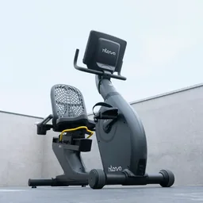</a> <b>#32</b> Dark grey recumbent exercise bike on a pale rooftop terrace exercise-bike · photograph · borderline (member-debatable) · Meets target clarity Intenza Fitness · <a href="https://unsplash.com/license">Unsplash License</a> Visual: approved · rights: approved 

Unresolved (2)
The photographer is the equipment maker; small product logos are visible and no endorsement is implied.  A recumbent model on a terrace rather than an upright bike in a gym; it still reads at once as a stationary exercise bike.
</td>
<td width="33%" valign="top"><a href="standardized/bicycles/photo-unsplash-1755092756284-226aea1995b6-standardized-v1.webp">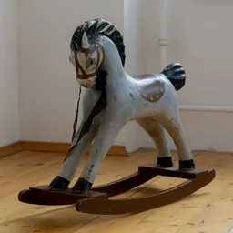</a> <b>#33</b> Vintage dappled rocking horse on a wooden floor rocking-horse · photograph · distractor (non-member) · Meets target clarity Georgii Eletskikh · <a href="https://unsplash.com/license">Unsplash License</a> Visual: approved · rights: approved</td>
</tr>
<tr>
<td width="33%" valign="top"><a href="standardized/bicycles/photo-pexels-9371876-standardized-v1.webp">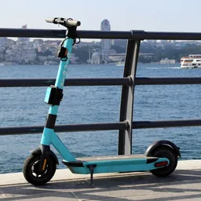</a> <b>#34</b> Turquoise electric kick scooter by a waterfront railing kick-scooter · photograph · distractor (non-member) · Meets target clarity Şahin Sezer Dinçer · <a href="https://www.pexels.com/license/">Pexels License</a> Visual: approved · rights: approved 

Unresolved (1)
A shared electric kick scooter; the railing passes behind it, not in front.
</td>
<td width="33%" valign="top"><a href="standardized/bicycles/photo-unsplash-1507035895480-2b3156c31fc8-standardized-v2.webp">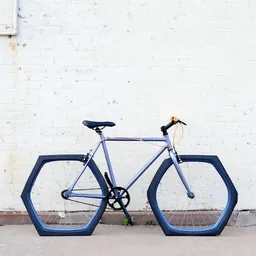</a> <b>#35</b> Lavender bicycle with hexagonal wheels against a white brick wall bicycle · ai-edited-photograph · target (member-bizarre) · Meets target clarity Tiffany Nutt · <a href="https://unsplash.com/license">Unsplash License</a> Visual: approved · rights: approved 

Unresolved (1)
The concept asks for square wheels; the edit produced hexagonal wheels, which serve the same joke.
</td>
<td width="33%" valign="top"> <b>#37</b> Grey horse fitted with handlebars, a saddle, pedals and two bicycle wheels in a meadow horse · ai-generated · borderline (member-debatable) · Meets target clarity Department of Human Verification (generated with FLUX.2 [klein] 4B) · <a href="https://www.apache.org/licenses/LICENSE-2.0">Project-generated image (FLUX.2 [klein] 4B, Apache-2.0 model)</a> Visual: approved · rights: approved 

Unresolved (1)
Generated image; the pedals are small at tile size.
</td>
</tr>
</table>

### Manipulated

<table>
<tr>
<td width="33%" valign="top"> Lavender bicycle with hexagonal wheels against a white brick wall bicycle · ai-edited-photograph · target (member-bizarre) · Meets target clarity Tiffany Nutt · <a href="https://unsplash.com/license">Unsplash License</a> Visual: approved · rights: approved 

Unresolved (1)
The concept asks for square wheels; the edit produced hexagonal wheels, which serve the same joke.
</td>
<td width="33%" valign="top"><a href="manipulated/bicycles/generated-bicycles-pedal-horse-v1.png">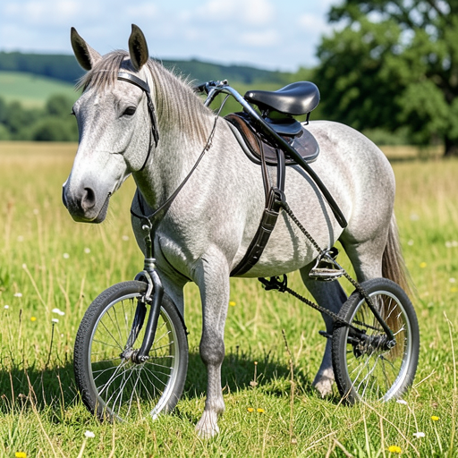</a> Grey horse fitted with handlebars, a saddle, pedals and two bicycle wheels in a meadow horse · ai-generated · borderline (member-debatable) · Meets target clarity Department of Human Verification (generated with FLUX.2 [klein] 4B) · <a href="https://www.apache.org/licenses/LICENSE-2.0">Project-generated image (FLUX.2 [klein] 4B, Apache-2.0 model)</a> Visual: approved · rights: approved 

Unresolved (1)
Generated image; the pedals are small at tile size.
</td>
</tr>
</table>

### Final sets

None yet.

## cars

Suitable: 6 · awaiting review: 0 · rejected: 0 · standardised: 6 · manipulated: 0 · final sets: 0

### Suitable

Rights-verified and visually reviewed, by rank.

<table>
<tr>
<td width="33%" valign="top"> <b>#1</b> Blue five-door hatchback parked side-on in a sunlit car park in front of a hedge and a glass office building hatchback · photograph · target (member-normal) · Meets target clarity Ionut Vlad · <a href="https://unsplash.com/license">Unsplash License</a> Visual: approved · rights: approved 

Unresolved (2)
Small manufacturer badges on the car  Glass building and hedge in the upper background
</td>
<td width="33%" valign="top"> <b>#2</b> Light-blue older estate car with a white roof box parked side-on in front of a white wall estate-car · photograph · target (member-normal) · Meets target clarity Xingdong Yu · <a href="https://unsplash.com/license">Unsplash License</a> Visual: approved · rights: approved 

Unresolved (3)
Roof box adds to the silhouette  Small painted characters on the wall above the car  Apartment balconies and a street lamp in the upper background
</td>
<td width="33%" valign="top"> <b>#3</b> Classic two-tone ivory and blue roadster with its roof down, parked side-on on a cobbled street convertible · photograph · target (member-normal) · Meets target clarity Sasha Pleshco · <a href="https://unsplash.com/license">Unsplash License</a> Visual: approved · rights: approved 

Unresolved (2)
Pale body against grey stonework gives only moderate contrast  Barred windows of the building fill the upper background
</td>
</tr>
<tr>
<td width="33%" valign="top"> <b>#4</b> Black convertible saloon with its roof down standing on a gravel mountain lay-by convertible · photograph · target (member-normal) · Meets target clarity Nikola Tasic · <a href="https://unsplash.com/license">Unsplash License</a> Visual: approved · rights: approved 

Unresolved (3)
Front three-quarter view rather than side-on  Front number plate and manufacturer badge visible  Offered for colour variety against the blue hatchback and estate
</td>
<td width="33%" valign="top"> <b>#5</b> Red wheelbarrow with wooden handles and garden waste parked side-on against a white-painted brick wall wheelbarrow · photograph · distractor (non-member) · Meets target clarity Rachel Claire · <a href="https://www.pexels.com/license/">Pexels License</a> Visual: approved · rights: approved 

Unresolved (2)
Brand name painted on the tray  Red pillar at the left edge
</td>
<td width="33%" valign="top"> <b>#6</b> Yellow and black motorcycle parked by a pale stone wall with ivy motorcycle · photograph · distractor (non-member) · Meets target clarity Joshua Brown · <a href="https://www.pexels.com/license/">Pexels License</a> Visual: approved · rights: approved 

Unresolved (1)
Brand badges are visible on the tank; no endorsement is implied.
</td>
</tr>
</table>

### Standardised

<table>
<tr>
<td width="33%" valign="top"><a href="standardized/cars/photo-unsplash-1777998567525-b48a50c54d1c-standardized-v1.webp">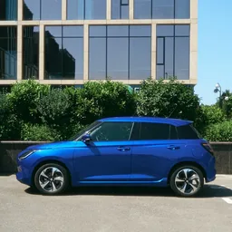</a> <b>#1</b> Blue five-door hatchback parked side-on in a sunlit car park in front of a hedge and a glass office building hatchback · photograph · target (member-normal) · Meets target clarity Ionut Vlad · <a href="https://unsplash.com/license">Unsplash License</a> Visual: approved · rights: approved 

Unresolved (2)
Small manufacturer badges on the car  Glass building and hedge in the upper background
</td>
<td width="33%" valign="top"><a href="standardized/cars/photo-unsplash-1760162754961-ed27f26b394f-standardized-v1.webp">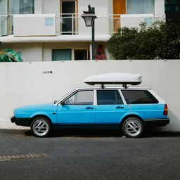</a> <b>#2</b> Light-blue older estate car with a white roof box parked side-on in front of a white wall estate-car · photograph · target (member-normal) · Meets target clarity Xingdong Yu · <a href="https://unsplash.com/license">Unsplash License</a> Visual: approved · rights: approved 

Unresolved (3)
Roof box adds to the silhouette  Small painted characters on the wall above the car  Apartment balconies and a street lamp in the upper background
</td>
<td width="33%" valign="top"><a href="standardized/cars/photo-unsplash-1662412765790-2b97cc3dbc6f-standardized-v1.webp">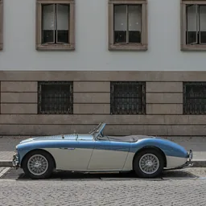</a> <b>#3</b> Classic two-tone ivory and blue roadster with its roof down, parked side-on on a cobbled street convertible · photograph · target (member-normal) · Meets target clarity Sasha Pleshco · <a href="https://unsplash.com/license">Unsplash License</a> Visual: approved · rights: approved 

Unresolved (2)
Pale body against grey stonework gives only moderate contrast  Barred windows of the building fill the upper background
</td>
</tr>
<tr>
<td width="33%" valign="top"><a href="standardized/cars/photo-unsplash-1763406348286-bf9067a05d5e-standardized-v1.webp">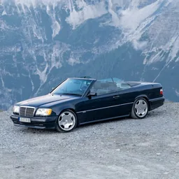</a> <b>#4</b> Black convertible saloon with its roof down standing on a gravel mountain lay-by convertible · photograph · target (member-normal) · Meets target clarity Nikola Tasic · <a href="https://unsplash.com/license">Unsplash License</a> Visual: approved · rights: approved 

Unresolved (3)
Front three-quarter view rather than side-on  Front number plate and manufacturer badge visible  Offered for colour variety against the blue hatchback and estate
</td>
<td width="33%" valign="top"><a href="standardized/cars/photo-pexels-5490910-standardized-v1.webp">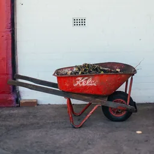</a> <b>#5</b> Red wheelbarrow with wooden handles and garden waste parked side-on against a white-painted brick wall wheelbarrow · photograph · distractor (non-member) · Meets target clarity Rachel Claire · <a href="https://www.pexels.com/license/">Pexels License</a> Visual: approved · rights: approved 

Unresolved (2)
Brand name painted on the tray  Red pillar at the left edge
</td>
<td width="33%" valign="top"><a href="standardized/cars/photo-pexels-17963040-standardized-v1.webp">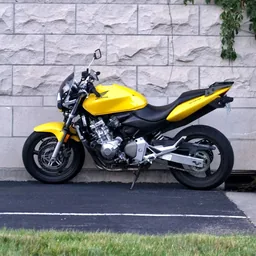</a> <b>#6</b> Yellow and black motorcycle parked by a pale stone wall with ivy motorcycle · photograph · distractor (non-member) · Meets target clarity Joshua Brown · <a href="https://www.pexels.com/license/">Pexels License</a> Visual: approved · rights: approved 

Unresolved (1)
Brand badges are visible on the tank; no endorsement is implied.
</td>
</tr>
</table>

### Manipulated

None yet.

### Final sets

None yet.

## houses

Suitable: 8 · awaiting review: 0 · rejected: 0 · standardised: 8 · manipulated: 0 · final sets: 0

### Suitable

Rights-verified and visually reviewed, by rank.

<table>
<tr>
<td width="33%" valign="top"> <b>#1</b> Pale-blue two-storey terraced house with a yellow front door and a walled front garden in a city street terraced-house · photograph · target (member-normal) · Meets target clarity Sonya Livshits · <a href="https://www.pexels.com/license/">Pexels License</a> Visual: approved · rights: approved 

Unresolved (3)
Parts of the neighbouring houses of the terrace are visible at both sides (inherent to the item)  Street lamp beside the house at the right  Overhead cables across the facade
</td>
<td width="33%" valign="top"> <b>#2</b> White two-storey detached house with dark trim and twin chimneys behind a low garden wall detached-house · photograph · target (member-normal) · Meets target clarity Adrien Olichon · <a href="https://unsplash.com/license">Unsplash License</a> Visual: approved · rights: approved 

Unresolved (3)
Thin slivers of neighbouring houses at the left and right crop edges  Bollards in front of the garden wall  Overcast sky
</td>
<td width="33%" valign="top"> <b>#3</b> Blue-grey two-storey detached house with an attached garage behind a large striped lawn detached-house · photograph · target (member-normal) · Meets target clarity Curtis Adams · <a href="https://www.pexels.com/license/">Pexels License</a> Visual: approved · rights: approved 

Unresolved (3)
House sits in the upper-middle with a large lawn foreground  Satellite dish on the roof  Bare trees behind the roof
</td>
</tr>
<tr>
<td width="33%" valign="top"> <b>#4</b> White single-storey bungalow with a brown metal hipped roof and a covered porch on open ground bungalow · photograph · target (member-normal) · Meets target clarity Andy Coffie · <a href="https://www.pexels.com/license/">Pexels License</a> Visual: approved · rights: approved 

Unresolved (4)
Large overcast sky in the upper half  Power lines in the background  Edge of a black water tank at the right crop edge  Unfinished, construction-site surroundings
</td>
<td width="33%" valign="top"> <b>#5</b> Black timber single-storey cottage with yellow window frames on a shingle beach behind a gorse bush bungalow · photograph · target (member-normal) · Meets target clarity Zoltan Tasi · <a href="https://unsplash.com/license">Unsplash License</a> Visual: approved · rights: approved 

Unresolved (4)
Gorse bush covers the lower front  Muted colour grading  Large shingle foreground  Appears to be the well-known Prospect Cottage at Dungeness, with lettering on the side wall
</td>
<td width="33%" valign="top"> <b>#6</b> Glass office tower above a glazed podium on a canal embankment under a clear blue sky office-tower · photograph · distractor (non-member) · Meets target clarity Wolfgang Weiser · <a href="https://unsplash.com/license">Unsplash License</a> Visual: approved · rights: approved 

Unresolved (4)
Tower and podium span about 93% of the crop vertically, slightly above the 90% target  Podium cut at the left edge  Small lettering at the top of the facade  Church spire and low buildings at the base
</td>
</tr>
<tr>
<td width="33%" valign="top"> <b>#7</b> Rustic metal roadside bus shelter with a bench beside a green field bus-shelter · photograph · distractor (non-member) · Meets target clarity Alexander Lunyov · <a href="https://unsplash.com/license">Unsplash License</a> Visual: approved · rights: approved 

Unresolved (3)
Frontal view  Torn poster remnants on the back panel  Dusk light with a lilac sky
</td>
<td width="33%" valign="top"> <b>#8</b> Faded white shipping container standing on dry grass at the edge of woodland shipping-container · photograph · distractor (non-member) · Meets target clarity Arlind Photography · <a href="https://unsplash.com/license">Unsplash License</a> Visual: approved · rights: approved 

Unresolved (4)
Warm low evening sun with some haze  Ivy over the left end  Lamp post behind the container  Faint stencilled lettering on the side
</td>
</tr>
</table>

### Standardised

<table>
<tr>
<td width="33%" valign="top"><a href="standardized/houses/photo-pexels-9828297-standardized-v1.webp">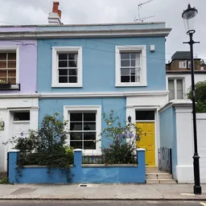</a> <b>#1</b> Pale-blue two-storey terraced house with a yellow front door and a walled front garden in a city street terraced-house · photograph · target (member-normal) · Meets target clarity Sonya Livshits · <a href="https://www.pexels.com/license/">Pexels License</a> Visual: approved · rights: approved 

Unresolved (3)
Parts of the neighbouring houses of the terrace are visible at both sides (inherent to the item)  Street lamp beside the house at the right  Overhead cables across the facade
</td>
<td width="33%" valign="top"><a href="standardized/houses/photo-unsplash-1761406938960-2f26b923a24e-standardized-v1.webp">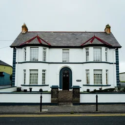</a> <b>#2</b> White two-storey detached house with dark trim and twin chimneys behind a low garden wall detached-house · photograph · target (member-normal) · Meets target clarity Adrien Olichon · <a href="https://unsplash.com/license">Unsplash License</a> Visual: approved · rights: approved 

Unresolved (3)
Thin slivers of neighbouring houses at the left and right crop edges  Bollards in front of the garden wall  Overcast sky
</td>
<td width="33%" valign="top"><a href="standardized/houses/photo-pexels-3935320-standardized-v1.webp">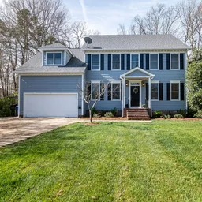</a> <b>#3</b> Blue-grey two-storey detached house with an attached garage behind a large striped lawn detached-house · photograph · target (member-normal) · Meets target clarity Curtis Adams · <a href="https://www.pexels.com/license/">Pexels License</a> Visual: approved · rights: approved 

Unresolved (3)
House sits in the upper-middle with a large lawn foreground  Satellite dish on the roof  Bare trees behind the roof
</td>
</tr>
<tr>
<td width="33%" valign="top"><a href="standardized/houses/photo-pexels-30762640-standardized-v1.webp">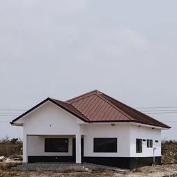</a> <b>#4</b> White single-storey bungalow with a brown metal hipped roof and a covered porch on open ground bungalow · photograph · target (member-normal) · Meets target clarity Andy Coffie · <a href="https://www.pexels.com/license/">Pexels License</a> Visual: approved · rights: approved 

Unresolved (4)
Large overcast sky in the upper half  Power lines in the background  Edge of a black water tank at the right crop edge  Unfinished, construction-site surroundings
</td>
<td width="33%" valign="top"><a href="standardized/houses/photo-unsplash-1542314820-e04ce1d3d81a-standardized-v1.webp">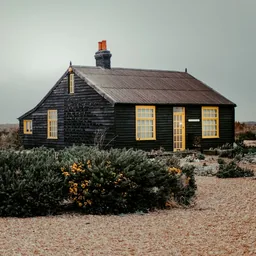</a> <b>#5</b> Black timber single-storey cottage with yellow window frames on a shingle beach behind a gorse bush bungalow · photograph · target (member-normal) · Meets target clarity Zoltan Tasi · <a href="https://unsplash.com/license">Unsplash License</a> Visual: approved · rights: approved 

Unresolved (4)
Gorse bush covers the lower front  Muted colour grading  Large shingle foreground  Appears to be the well-known Prospect Cottage at Dungeness, with lettering on the side wall
</td>
<td width="33%" valign="top"><a href="standardized/houses/photo-unsplash-1792745119435-73b06f2eabc9-standardized-v1.webp">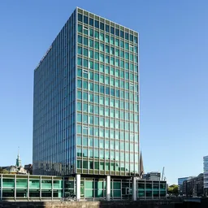</a> <b>#6</b> Glass office tower above a glazed podium on a canal embankment under a clear blue sky office-tower · photograph · distractor (non-member) · Meets target clarity Wolfgang Weiser · <a href="https://unsplash.com/license">Unsplash License</a> Visual: approved · rights: approved 

Unresolved (4)
Tower and podium span about 93% of the crop vertically, slightly above the 90% target  Podium cut at the left edge  Small lettering at the top of the facade  Church spire and low buildings at the base
</td>
</tr>
<tr>
<td width="33%" valign="top"><a href="standardized/houses/photo-unsplash-1781807763892-29f7f7b70b6a-standardized-v1.webp">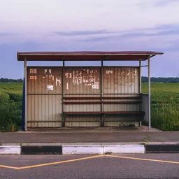</a> <b>#7</b> Rustic metal roadside bus shelter with a bench beside a green field bus-shelter · photograph · distractor (non-member) · Meets target clarity Alexander Lunyov · <a href="https://unsplash.com/license">Unsplash License</a> Visual: approved · rights: approved 

Unresolved (3)
Frontal view  Torn poster remnants on the back panel  Dusk light with a lilac sky
</td>
<td width="33%" valign="top"><a href="standardized/houses/photo-unsplash-1790364755326-ad7b61618cf2-standardized-v1.webp">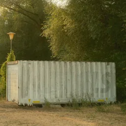</a> <b>#8</b> Faded white shipping container standing on dry grass at the edge of woodland shipping-container · photograph · distractor (non-member) · Meets target clarity Arlind Photography · <a href="https://unsplash.com/license">Unsplash License</a> Visual: approved · rights: approved 

Unresolved (4)
Warm low evening sun with some haze  Ivy over the left end  Lamp post behind the container  Faint stencilled lettering on the side
</td>
</tr>
</table>

### Manipulated

None yet.

### Final sets

None yet.

## lamps

Suitable: 7 · awaiting review: 0 · rejected: 0 · standardised: 7 · manipulated: 0 · final sets: 0

### Suitable

Rights-verified and visually reviewed, by rank.

<table>
<tr>
<td width="33%" valign="top"> <b>#1</b> Black enamelled jointed-arm desk lamp on a small white table against an olive-green wall desk-lamp · photograph · target (member-normal) · Meets target clarity Steffen Petermann · <a href="https://unsplash.com/license">Unsplash License</a> Visual: approved · rights: approved 

Unresolved (2)
Lamp spans about 90% of the crop width; margins are small on both sides  Lamp is unlit
</td>
<td width="33%" valign="top"> <b>#2</b> Lit tripod floor lamp with a cylindrical shade and wooden legs on a herringbone parquet floor against a dark wall floor-lamp · photograph · target (member-normal) · Meets target clarity Javier Miranda · <a href="https://unsplash.com/license">Unsplash License</a> Visual: approved · rights: approved 

Unresolved (1)
Dark, low-key scene; legs read well but the background is near black
</td>
<td width="33%" valign="top"> <b>#3</b> Table lamp with a white shade and patterned ceramic base on a dark bedside table beside a bed and a small glass of yellow roses bedside-lamp · photograph · target (member-normal) · Meets target clarity Curtis Adams · <a href="https://www.pexels.com/license/">Pexels License</a> Visual: approved · rights: approved 

Unresolved (2)
Shade glow is subtle in daylight  Small glass of yellow roses beside the lamp (a vase is a non-member item in this theme)
</td>
</tr>
<tr>
<td width="33%" valign="top"> <b>#4</b> Tall blue ceramic vase painted with cranes and pink lotus flowers on a plain light-grey background vase · photograph · distractor (non-member) · Meets target clarity Cuong Duyen Ceramics · <a href="https://unsplash.com/license">Unsplash License</a> Visual: approved · rights: approved 

Unresolved (2)
Studio product shot rather than an everyday setting  Painted decoration is an artwork by the maker; noted for the Unsplash artwork exclusion
</td>
<td width="33%" valign="top"> <b>#5</b> White and grey ceramic vase with a green eucalyptus sprig on a white tablecloth against a grey wall vase · photograph · distractor (non-member) · Meets target clarity Shashi Chaturvedula · <a href="https://unsplash.com/license">Unsplash License</a> Visual: approved · rights: approved 

Unresolved (1)
White vase on a white cloth; figure-ground contrast is moderate at the base
</td>
<td width="33%" valign="top"> <b>#6</b> Wooden box hand coffee grinder with a black hopper and crank handle on a wooden table against a dark teal wall coffee-grinder · photograph · distractor (non-member) · Meets target clarity Ashkan Forouzani · <a href="https://unsplash.com/license">Unsplash License</a> Visual: approved · rights: approved 

Unresolved (2)
The word &quot;Coffee&quot; is embossed on the drawer front (small text)  Dark, moody lighting
</td>
</tr>
<tr>
<td width="33%" valign="top"> <b>#7</b> Yellow plastic watering can standing on mossy ground in front of a dark ivy hedge watering-can · photograph · distractor (non-member) · Meets target clarity Willy the Wizard · <a href="https://unsplash.com/license">Unsplash License</a> Visual: approved · rights: approved</td>
</tr>
</table>

### Standardised

<table>
<tr>
<td width="33%" valign="top"><a href="standardized/lamps/photo-unsplash-1647345287361-b2de799c49a1-standardized-v1.webp">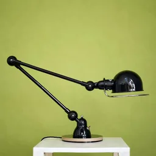</a> <b>#1</b> Black enamelled jointed-arm desk lamp on a small white table against an olive-green wall desk-lamp · photograph · target (member-normal) · Meets target clarity Steffen Petermann · <a href="https://unsplash.com/license">Unsplash License</a> Visual: approved · rights: approved 

Unresolved (2)
Lamp spans about 90% of the crop width; margins are small on both sides  Lamp is unlit
</td>
<td width="33%" valign="top"><a href="standardized/lamps/photo-unsplash-1632090944927-8dd1068e5f40-standardized-v1.webp">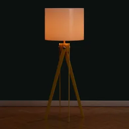</a> <b>#2</b> Lit tripod floor lamp with a cylindrical shade and wooden legs on a herringbone parquet floor against a dark wall floor-lamp · photograph · target (member-normal) · Meets target clarity Javier Miranda · <a href="https://unsplash.com/license">Unsplash License</a> Visual: approved · rights: approved 

Unresolved (1)
Dark, low-key scene; legs read well but the background is near black
</td>
<td width="33%" valign="top"><a href="standardized/lamps/photo-pexels-19227253-standardized-v1.webp">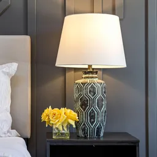</a> <b>#3</b> Table lamp with a white shade and patterned ceramic base on a dark bedside table beside a bed and a small glass of yellow roses bedside-lamp · photograph · target (member-normal) · Meets target clarity Curtis Adams · <a href="https://www.pexels.com/license/">Pexels License</a> Visual: approved · rights: approved 

Unresolved (2)
Shade glow is subtle in daylight  Small glass of yellow roses beside the lamp (a vase is a non-member item in this theme)
</td>
</tr>
<tr>
<td width="33%" valign="top"><a href="standardized/lamps/photo-unsplash-1723779232054-6f6be572c0e8-standardized-v1.webp">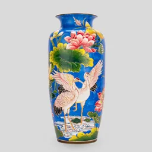</a> <b>#4</b> Tall blue ceramic vase painted with cranes and pink lotus flowers on a plain light-grey background vase · photograph · distractor (non-member) · Meets target clarity Cuong Duyen Ceramics · <a href="https://unsplash.com/license">Unsplash License</a> Visual: approved · rights: approved 

Unresolved (2)
Studio product shot rather than an everyday setting  Painted decoration is an artwork by the maker; noted for the Unsplash artwork exclusion
</td>
<td width="33%" valign="top"><a href="standardized/lamps/photo-unsplash-1610635966675-f6fcaaf9b833-standardized-v1.webp">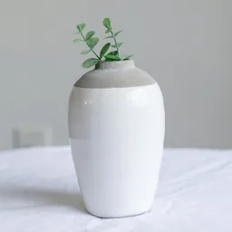</a> <b>#5</b> White and grey ceramic vase with a green eucalyptus sprig on a white tablecloth against a grey wall vase · photograph · distractor (non-member) · Meets target clarity Shashi Chaturvedula · <a href="https://unsplash.com/license">Unsplash License</a> Visual: approved · rights: approved 

Unresolved (1)
White vase on a white cloth; figure-ground contrast is moderate at the base
</td>
<td width="33%" valign="top"><a href="standardized/lamps/photo-unsplash-1573066380308-24ff4c273dbc-standardized-v1.webp">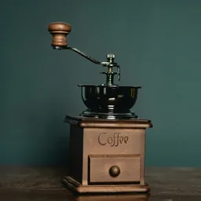</a> <b>#6</b> Wooden box hand coffee grinder with a black hopper and crank handle on a wooden table against a dark teal wall coffee-grinder · photograph · distractor (non-member) · Meets target clarity Ashkan Forouzani · <a href="https://unsplash.com/license">Unsplash License</a> Visual: approved · rights: approved 

Unresolved (2)
The word &quot;Coffee&quot; is embossed on the drawer front (small text)  Dark, moody lighting
</td>
</tr>
<tr>
<td width="33%" valign="top"><a href="standardized/lamps/photo-unsplash-1692651771569-95dd3ed878a8-standardized-v1.webp">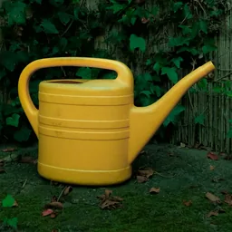</a> <b>#7</b> Yellow plastic watering can standing on mossy ground in front of a dark ivy hedge watering-can · photograph · distractor (non-member) · Meets target clarity Willy the Wizard · <a href="https://unsplash.com/license">Unsplash License</a> Visual: approved · rights: approved</td>
</tr>
</table>

### Manipulated

None yet.

### Final sets

None yet.

## shoes

Suitable: 7 · awaiting review: 0 · rejected: 0 · standardised: 7 · manipulated: 0 · final sets: 0

### Suitable

Rights-verified and visually reviewed, by rank.

<table>
<tr>
<td width="33%" valign="top"> <b>#1</b> Single white leather trainer standing on dark tarmac in an underground car park with blurred ceiling lights trainer · photograph · target (member-normal) · Meets target clarity Omar Prestwich · <a href="https://unsplash.com/license">Unsplash License</a> Visual: approved · rights: approved 

Unresolved (2)
Small K-Swiss shield logo and lettering on the side  Bright ceiling lights in the blurred background
</td>
<td width="33%" valign="top"> <b>#2</b> Single tan whole-cut lace-up dress shoe with hand-tooled floral leather on a glossy black surface dress-shoe · photograph · target (member-normal) · Meets target clarity Prateek Chawla · <a href="https://unsplash.com/license">Unsplash License</a> Visual: approved · rights: approved 

Unresolved (2)
Ornate hand-tooled floral leather is less typical than a plain dress shoe  Studio shot on black with a visible reflection rather than an everyday setting
</td>
<td width="33%" valign="top"> <b>#3</b> Single red children's wellington boot with a bunny print and buckle strap standing on moss under hawthorn leaves wellington-boot · photograph · target (member-normal) · Meets target clarity Lee Hanson · <a href="https://www.pexels.com/license/">Pexels License</a> Visual: approved · rights: approved 

Unresolved (2)
Child-size boot with a decorative bunny print  Staged placement on a mossy tree base
</td>
</tr>
<tr>
<td width="33%" valign="top"> <b>#4</b> Close-up of a pale horse's lower leg and hoof standing on a gravel road, with the metal horseshoe visible along the hoof's edge horseshoe-on-hoof · photograph · borderline (member-debatable) · Meets target clarity Ollie Craig · <a href="https://www.pexels.com/license/">Pexels License</a> Visual: approved · rights: approved 

Unresolved (2)
The leg necessarily continues beyond the top and left edges of a hoof close-up  The shoe is seen as a dark rim along the hoof rather than its full U shape
</td>
<td width="33%" valign="top"> <b>#5</b> Red and navy leather top-handle handbag with a gold clasp standing on a plain grey surface handbag · photograph · distractor (non-member) · Meets target clarity Fashion Needles · <a href="https://unsplash.com/license">Unsplash License</a> Visual: approved · rights: approved 

Unresolved (2)
Small brand name engraved on the gold clasp plate  Studio product shot
</td>
<td width="33%" valign="top"> <b>#6</b> Green, yellow and orange vented cycling helmet resting on a weathered concrete wall top bicycle-helmet · photograph · distractor (non-member) · Meets target clarity Danilo Lessa Bernardineli · <a href="https://unsplash.com/license">Unsplash License</a> Visual: approved · rights: approved 

Unresolved (2)
Brand lettering (VAN RYSEL) printed on the side is legible  Unusual mottled custom paint finish
</td>
</tr>
<tr>
<td width="33%" valign="top"> <b>#7</b> Single worn yellow leather work glove lying flat on a light-grey surface glove · photograph · distractor (non-member) · Meets target clarity Nicolas Solerieu · <a href="https://unsplash.com/license">Unsplash License</a> Visual: approved · rights: approved 

Unresolved (1)
Plain studio-like background
</td>
</tr>
</table>

### Standardised

<table>
<tr>
<td width="33%" valign="top"><a href="standardized/shoes/photo-unsplash-1595805737846-ab795bc2c782-standardized-v1.webp">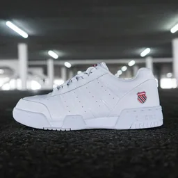</a> <b>#1</b> Single white leather trainer standing on dark tarmac in an underground car park with blurred ceiling lights trainer · photograph · target (member-normal) · Meets target clarity Omar Prestwich · <a href="https://unsplash.com/license">Unsplash License</a> Visual: approved · rights: approved 

Unresolved (2)
Small K-Swiss shield logo and lettering on the side  Bright ceiling lights in the blurred background
</td>
<td width="33%" valign="top"><a href="standardized/shoes/photo-unsplash-1634304138376-43a922e96c80-standardized-v1.webp">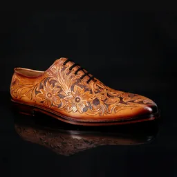</a> <b>#2</b> Single tan whole-cut lace-up dress shoe with hand-tooled floral leather on a glossy black surface dress-shoe · photograph · target (member-normal) · Meets target clarity Prateek Chawla · <a href="https://unsplash.com/license">Unsplash License</a> Visual: approved · rights: approved 

Unresolved (2)
Ornate hand-tooled floral leather is less typical than a plain dress shoe  Studio shot on black with a visible reflection rather than an everyday setting
</td>
<td width="33%" valign="top"><a href="standardized/shoes/photo-pexels-37722620-standardized-v1.webp">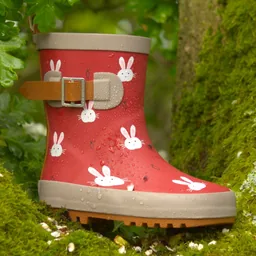</a> <b>#3</b> Single red children's wellington boot with a bunny print and buckle strap standing on moss under hawthorn leaves wellington-boot · photograph · target (member-normal) · Meets target clarity Lee Hanson · <a href="https://www.pexels.com/license/">Pexels License</a> Visual: approved · rights: approved 

Unresolved (2)
Child-size boot with a decorative bunny print  Staged placement on a mossy tree base
</td>
</tr>
<tr>
<td width="33%" valign="top"><a href="standardized/shoes/photo-pexels-5405827-standardized-v1.webp">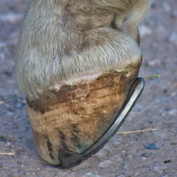</a> <b>#4</b> Close-up of a pale horse's lower leg and hoof standing on a gravel road, with the metal horseshoe visible along the hoof's edge horseshoe-on-hoof · photograph · borderline (member-debatable) · Meets target clarity Ollie Craig · <a href="https://www.pexels.com/license/">Pexels License</a> Visual: approved · rights: approved 

Unresolved (2)
The leg necessarily continues beyond the top and left edges of a hoof close-up  The shoe is seen as a dark rim along the hoof rather than its full U shape
</td>
<td width="33%" valign="top"><a href="standardized/shoes/photo-unsplash-1751522925876-79bfeae6fbfb-standardized-v1.webp">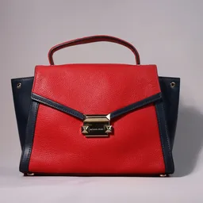</a> <b>#5</b> Red and navy leather top-handle handbag with a gold clasp standing on a plain grey surface handbag · photograph · distractor (non-member) · Meets target clarity Fashion Needles · <a href="https://unsplash.com/license">Unsplash License</a> Visual: approved · rights: approved 

Unresolved (2)
Small brand name engraved on the gold clasp plate  Studio product shot
</td>
<td width="33%" valign="top"><a href="standardized/shoes/photo-unsplash-1702693008936-112724759019-standardized-v1.webp">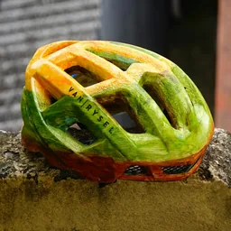</a> <b>#6</b> Green, yellow and orange vented cycling helmet resting on a weathered concrete wall top bicycle-helmet · photograph · distractor (non-member) · Meets target clarity Danilo Lessa Bernardineli · <a href="https://unsplash.com/license">Unsplash License</a> Visual: approved · rights: approved 

Unresolved (2)
Brand lettering (VAN RYSEL) printed on the side is legible  Unusual mottled custom paint finish
</td>
</tr>
<tr>
<td width="33%" valign="top"><a href="standardized/shoes/photo-unsplash-1673294861057-4584f92b91d2-standardized-v1.webp">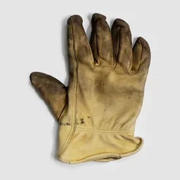</a> <b>#7</b> Single worn yellow leather work glove lying flat on a light-grey surface glove · photograph · distractor (non-member) · Meets target clarity Nicolas Solerieu · <a href="https://unsplash.com/license">Unsplash License</a> Visual: approved · rights: approved 

Unresolved (1)
Plain studio-like background
</td>
</tr>
</table>

### Manipulated

None yet.

### Final sets

None yet.

## clocks

Suitable: 8 · awaiting review: 0 · rejected: 0 · standardised: 8 · manipulated: 0 · final sets: 0

### Suitable

Rights-verified and visually reviewed, by rank.

<table>
<tr>
<td width="33%" valign="top"> <b>#1</b> Round wall clock with a mint-green rim and white dial on a plain cream wall wall-clock · photograph · target (member-normal) · Meets target clarity Debby Hudson · <a href="https://unsplash.com/license">Unsplash License</a> Visual: approved · rights: approved 

Unresolved (1)
Frontal view; the hanging point is hidden behind the clock
</td>
<td width="33%" valign="top"> <b>#2</b> Lime-green twin-bell alarm clock standing on a beige surface alarm-clock · photograph · target (member-normal) · Meets target clarity Jafaris Mustafa · <a href="https://www.pexels.com/license/">Pexels License</a> Visual: approved · rights: approved 

Unresolved (2)
Plain studio-like backdrop rather than a room setting  Small 'World Time' and 'QUARTZ' text on the dial
</td>
<td width="33%" valign="top"> <b>#3</b> Navy-blue twin-bell alarm clock on a wooden table against a pale wall alarm-clock · photograph · target (member-normal) · Meets target clarity Enikő Tóth · <a href="https://www.pexels.com/license/">Pexels License</a> Visual: approved · rights: approved 

Unresolved (2)
Frontal view  Small 'QUARTZ' text on the dial
</td>
</tr>
<tr>
<td width="33%" valign="top"> <b>#4</b> Dark wooden longcase clock standing against a white wall between two windows longcase-clock · photograph · target (member-normal) · Meets target clarity Klaus Nenning · <a href="https://www.pexels.com/license/">Pexels License</a> Visual: approved · rights: approved 

Unresolved (4)
Frontal view (the characteristic view of a longcase clock)  Tall, narrow object: about 30% of the crop width  A small black cable lies on the floor beneath the clock  Window frames at both crop edges
</td>
<td width="33%" valign="top"> <b>#5</b> Bronze octagonal sundial with a tall gnomon on a stone pedestal in a grassy park sundial · photograph · borderline (member-debatable) · Meets target clarity Jigar Patel · <a href="https://www.pexels.com/license/">Pexels License</a> Visual: approved · rights: approved 

Unresolved (4)
Pedestal continues beyond the bottom edge of the crop  Pedestal top spans about 90% of the crop width, leaving narrow side margins  Slightly elevated viewpoint  Small engraved text on the dial plate
</td>
<td width="33%" valign="top"> <b>#6</b> Round wall mirror with a thin wooden frame on a white wall, reflecting a bedroom skylight wall-mirror · photograph · distractor (non-member) · Meets target clarity Liza Pooor · <a href="https://unsplash.com/license">Unsplash License</a> Visual: approved · rights: approved 

Unresolved (2)
Reflection shows a brass bed frame and a skylight  Right margin narrower than the left (83 px against 144 px of 1,140)
</td>
</tr>
<tr>
<td width="33%" valign="top"> <b>#7</b> Hand-painted ceramic plate with red poppies hanging on a teal wall decorative-plate · photograph · distractor (non-member) · Meets target clarity Vera Emilie · <a href="https://www.pexels.com/license/">Pexels License</a> Visual: approved · rights: approved 

Unresolved (2)
Flat disc with a hanging hole; it may read as a painted tile rather than a plate  Edge of a second plate lies outside the crop at the top right of the photograph
</td>
<td width="33%" valign="top"> <b>#8</b> Silver magnetic compass with a black dial lying on a sawn tree stump magnetic-compass · photograph · distractor (non-member) · Meets target clarity Jametlene Reskp · <a href="https://unsplash.com/license">Unsplash License</a> Visual: approved · rights: approved 

Unresolved (3)
Elevated three-quarter view, needed to show the dial  Warm, high-contrast processing  The Unsplash alt text calls it a pocket watch; it is a compass
</td>
</tr>
</table>

### Standardised

<table>
<tr>
<td width="33%" valign="top"><a href="standardized/clocks/photo-unsplash-1558395872-85709c6d3639-standardized-v1.webp">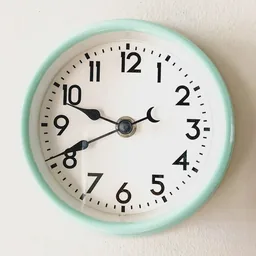</a> <b>#1</b> Round wall clock with a mint-green rim and white dial on a plain cream wall wall-clock · photograph · target (member-normal) · Meets target clarity Debby Hudson · <a href="https://unsplash.com/license">Unsplash License</a> Visual: approved · rights: approved 

Unresolved (1)
Frontal view; the hanging point is hidden behind the clock
</td>
<td width="33%" valign="top"><a href="standardized/clocks/photo-pexels-11747093-standardized-v1.webp">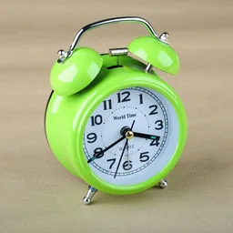</a> <b>#2</b> Lime-green twin-bell alarm clock standing on a beige surface alarm-clock · photograph · target (member-normal) · Meets target clarity Jafaris Mustafa · <a href="https://www.pexels.com/license/">Pexels License</a> Visual: approved · rights: approved 

Unresolved (2)
Plain studio-like backdrop rather than a room setting  Small 'World Time' and 'QUARTZ' text on the dial
</td>
<td width="33%" valign="top"><a href="standardized/clocks/photo-pexels-32815277-standardized-v1.webp">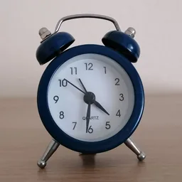</a> <b>#3</b> Navy-blue twin-bell alarm clock on a wooden table against a pale wall alarm-clock · photograph · target (member-normal) · Meets target clarity Enikő Tóth · <a href="https://www.pexels.com/license/">Pexels License</a> Visual: approved · rights: approved 

Unresolved (2)
Frontal view  Small 'QUARTZ' text on the dial
</td>
</tr>
<tr>
<td width="33%" valign="top"><a href="standardized/clocks/photo-pexels-40273146-standardized-v1.webp">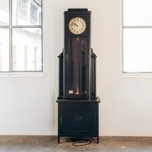</a> <b>#4</b> Dark wooden longcase clock standing against a white wall between two windows longcase-clock · photograph · target (member-normal) · Meets target clarity Klaus Nenning · <a href="https://www.pexels.com/license/">Pexels License</a> Visual: approved · rights: approved 

Unresolved (4)
Frontal view (the characteristic view of a longcase clock)  Tall, narrow object: about 30% of the crop width  A small black cable lies on the floor beneath the clock  Window frames at both crop edges
</td>
<td width="33%" valign="top"><a href="standardized/clocks/photo-pexels-27183730-standardized-v1.webp">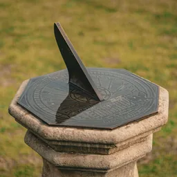</a> <b>#5</b> Bronze octagonal sundial with a tall gnomon on a stone pedestal in a grassy park sundial · photograph · borderline (member-debatable) · Meets target clarity Jigar Patel · <a href="https://www.pexels.com/license/">Pexels License</a> Visual: approved · rights: approved 

Unresolved (4)
Pedestal continues beyond the bottom edge of the crop  Pedestal top spans about 90% of the crop width, leaving narrow side margins  Slightly elevated viewpoint  Small engraved text on the dial plate
</td>
<td width="33%" valign="top"><a href="standardized/clocks/photo-unsplash-1619213348491-b7b7602727f9-standardized-v1.webp">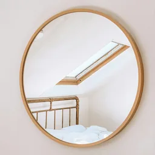</a> <b>#6</b> Round wall mirror with a thin wooden frame on a white wall, reflecting a bedroom skylight wall-mirror · photograph · distractor (non-member) · Meets target clarity Liza Pooor · <a href="https://unsplash.com/license">Unsplash License</a> Visual: approved · rights: approved 

Unresolved (2)
Reflection shows a brass bed frame and a skylight  Right margin narrower than the left (83 px against 144 px of 1,140)
</td>
</tr>
<tr>
<td width="33%" valign="top"><a href="standardized/clocks/photo-pexels-17343135-standardized-v1.webp">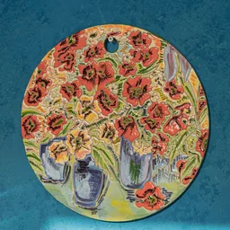</a> <b>#7</b> Hand-painted ceramic plate with red poppies hanging on a teal wall decorative-plate · photograph · distractor (non-member) · Meets target clarity Vera Emilie · <a href="https://www.pexels.com/license/">Pexels License</a> Visual: approved · rights: approved 

Unresolved (2)
Flat disc with a hanging hole; it may read as a painted tile rather than a plate  Edge of a second plate lies outside the crop at the top right of the photograph
</td>
<td width="33%" valign="top"><a href="standardized/clocks/photo-unsplash-1558978325-66dcf73b99b0-standardized-v1.webp">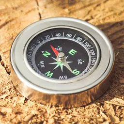</a> <b>#8</b> Silver magnetic compass with a black dial lying on a sawn tree stump magnetic-compass · photograph · distractor (non-member) · Meets target clarity Jametlene Reskp · <a href="https://unsplash.com/license">Unsplash License</a> Visual: approved · rights: approved 

Unresolved (3)
Elevated three-quarter view, needed to show the dial  Warm, high-contrast processing  The Unsplash alt text calls it a pocket watch; it is a compass
</td>
</tr>
</table>

### Manipulated

None yet.

### Final sets

None yet.

## boats

Suitable: 7 · awaiting review: 0 · rejected: 0 · standardised: 7 · manipulated: 0 · final sets: 0

### Suitable

Rights-verified and visually reviewed, by rank.

<table>
<tr>
<td width="33%" valign="top"> <b>#1</b> Red-brown wooden rowing boat moored on calm grey-blue water rowing-boat · photograph · target (member-normal) · Meets target clarity Rusty Watson · <a href="https://unsplash.com/license">Unsplash License</a> Visual: approved · rights: approved 

Unresolved (3)
Crop side only 560 px in the preview (above the 512 px minimum)  Reflections of mooring posts in the water above the boat  Part of the mooring line enters at the left edge; the buoy itself is outside the crop
</td>
<td width="33%" valign="top"> <b>#2</b> Varnished wooden rowing boat with an oar resting across it on rippled dark water rowing-boat · photograph · target (member-normal) · Meets target clarity V · <a href="https://unsplash.com/license">Unsplash License</a> Visual: approved · rights: approved 

Unresolved (4)
Crop side 610 px in the preview  Bright rippled reflections behind the boat  Saturated colour processing  Mooring line visible in the water
</td>
<td width="33%" valign="top"> <b>#3</b> White sloop under full sail on a blue lake with a wooded shore behind sailing-boat · photograph · target (member-normal) · Meets target clarity Gilly · <a href="https://unsplash.com/license">Unsplash License</a> Visual: approved · rights: approved 

Unresolved (3)
One tiny crew member is visible at the stern  Small sail number on the mainsail  Distant houses on the far shore
</td>
</tr>
<tr>
<td width="33%" valign="top"> <b>#4</b> Black-and-white passenger and vehicle ferry crossing open water with hills behind ferry · photograph · target (member-normal) · Meets target clarity Maarten Zaanen · <a href="https://unsplash.com/license">Unsplash License</a> Visual: approved · rights: approved 

Unresolved (3)
Operator name painted small on the hull (Caledonian MacBrayne)  Crop side 626 px in the preview  Purple-brown hills behind are busier than open sky
</td>
<td width="33%" valign="top"> <b>#5</b> Red classic Fiat 500 parked on a wet street in front of a grey wall with a roller shutter car · photograph · distractor (non-member) · Meets target clarity Andrea Ranalletta · <a href="https://unsplash.com/license">Unsplash License</a> Visual: approved · rights: approved 

Unresolved (2)
Recognisable car model (Fiat 500), though no badge is prominent  Wet road with reflections below the car
</td>
<td width="33%" valign="top"> <b>#6</b> Weathered wooden picnic table with attached benches in a woodland clearing picnic-table · photograph · distractor (non-member) · Meets target clarity Adrian Hernandez · <a href="https://unsplash.com/license">Unsplash License</a> Visual: approved · rights: approved 

Unresolved (2)
A dark barbecue grill stands behind the table  Dark forest background lowers contrast with the table legs
</td>
</tr>
<tr>
<td width="33%" valign="top"> <b>#7</b> Galvanised wheelbarrow with a red wheel standing on rough ground beside shrubs wheelbarrow · photograph · distractor (non-member) · Meets target clarity Marc Pell · <a href="https://unsplash.com/license">Unsplash License</a> Visual: approved · rights: approved 

Unresolved (3)
Crop limited by the 720 px preview height; the wheelbarrow spans 88%  Small blue object inside the tray  Grey tray against mixed green and brown background
</td>
</tr>
</table>

### Standardised

<table>
<tr>
<td width="33%" valign="top"><a href="standardized/boats/photo-unsplash-1724102894997-c30f6216cec6-standardized-v1.webp">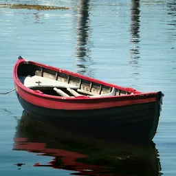</a> <b>#1</b> Red-brown wooden rowing boat moored on calm grey-blue water rowing-boat · photograph · target (member-normal) · Meets target clarity Rusty Watson · <a href="https://unsplash.com/license">Unsplash License</a> Visual: approved · rights: approved 

Unresolved (3)
Crop side only 560 px in the preview (above the 512 px minimum)  Reflections of mooring posts in the water above the boat  Part of the mooring line enters at the left edge; the buoy itself is outside the crop
</td>
<td width="33%" valign="top"> <b>#2</b> Varnished wooden rowing boat with an oar resting across it on rippled dark water rowing-boat · photograph · target (member-normal) · Meets target clarity V · <a href="https://unsplash.com/license">Unsplash License</a> Visual: approved · rights: approved 

Unresolved (4)
Crop side 610 px in the preview  Bright rippled reflections behind the boat  Saturated colour processing  Mooring line visible in the water
</td>
<td width="33%" valign="top"><a href="standardized/boats/photo-unsplash-1632899806837-400e81b33686-standardized-v1.webp">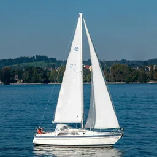</a> <b>#3</b> White sloop under full sail on a blue lake with a wooded shore behind sailing-boat · photograph · target (member-normal) · Meets target clarity Gilly · <a href="https://unsplash.com/license">Unsplash License</a> Visual: approved · rights: approved 

Unresolved (3)
One tiny crew member is visible at the stern  Small sail number on the mainsail  Distant houses on the far shore
</td>
</tr>
<tr>
<td width="33%" valign="top"> <b>#4</b> Black-and-white passenger and vehicle ferry crossing open water with hills behind ferry · photograph · target (member-normal) · Meets target clarity Maarten Zaanen · <a href="https://unsplash.com/license">Unsplash License</a> Visual: approved · rights: approved 

Unresolved (3)
Operator name painted small on the hull (Caledonian MacBrayne)  Crop side 626 px in the preview  Purple-brown hills behind are busier than open sky
</td>
<td width="33%" valign="top"><a href="standardized/boats/photo-unsplash-1739615124112-d5760c5a26df-standardized-v1.webp">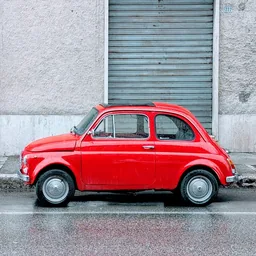</a> <b>#5</b> Red classic Fiat 500 parked on a wet street in front of a grey wall with a roller shutter car · photograph · distractor (non-member) · Meets target clarity Andrea Ranalletta · <a href="https://unsplash.com/license">Unsplash License</a> Visual: approved · rights: approved 

Unresolved (2)
Recognisable car model (Fiat 500), though no badge is prominent  Wet road with reflections below the car
</td>
<td width="33%" valign="top"><a href="standardized/boats/photo-unsplash-1635958068287-2f496bea08a4-standardized-v1.webp">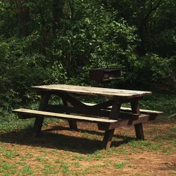</a> <b>#6</b> Weathered wooden picnic table with attached benches in a woodland clearing picnic-table · photograph · distractor (non-member) · Meets target clarity Adrian Hernandez · <a href="https://unsplash.com/license">Unsplash License</a> Visual: approved · rights: approved 

Unresolved (2)
A dark barbecue grill stands behind the table  Dark forest background lowers contrast with the table legs
</td>
</tr>
<tr>
<td width="33%" valign="top"><a href="standardized/boats/photo-unsplash-1723022468974-e06843cef1ab-standardized-v1.webp">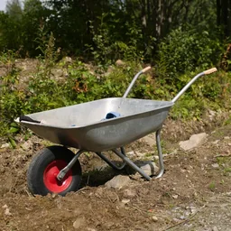</a> <b>#7</b> Galvanised wheelbarrow with a red wheel standing on rough ground beside shrubs wheelbarrow · photograph · distractor (non-member) · Meets target clarity Marc Pell · <a href="https://unsplash.com/license">Unsplash License</a> Visual: approved · rights: approved 

Unresolved (3)
Crop limited by the 720 px preview height; the wheelbarrow spans 88%  Small blue object inside the tray  Grey tray against mixed green and brown background
</td>
</tr>
</table>

### Manipulated

None yet.

### Final sets

None yet.

## computers

Suitable: 8 · awaiting review: 0 · rejected: 0 · standardised: 8 · manipulated: 0 · final sets: 0

### Suitable

Rights-verified and visually reviewed, by rank.

<table>
<tr>
<td width="33%" valign="top"> <b>#1</b> Space-grey laptop standing open on a white table beside a window laptop · photograph · target (member-normal) · Meets target clarity Rahul Chakraborty · <a href="https://unsplash.com/license">Unsplash License</a> Visual: approved · rights: approved 

Unresolved (2)
Screen shows a colourful default wallpaper  Laptop spans about 90% of the crop width, so side margins are small
</td>
<td width="33%" valign="top"> <b>#2</b> Desktop computer with monitor, glass-sided tower and keyboard on a white trestle desk desktop-computer · photograph · target (member-normal) · Meets target clarity I'M ZION · <a href="https://unsplash.com/license">Unsplash License</a> Visual: approved · rights: approved 

Unresolved (3)
The setup fills the upper half of the crop; the desk trestles fill the lower half  Tower shows coloured LED fan lighting  Monitor arm, small speaker, phone and other accessories on the desk; the camera rig at the far left is outside the crop
</td>
<td width="33%" valign="top"> <b>#3</b> White all-in-one desktop computer with keyboard and mouse on a white desk desktop-computer · photograph · target (member-normal) · Meets target clarity Hillary Black · <a href="https://unsplash.com/license">Unsplash License</a> Visual: approved · rights: approved 

Unresolved (4)
All-in-one design: no separate tower, unlike the planned item  Keyboard and desk mat are cut by the crop edges  Small Apple logo on the monitor chin  Water bottle partly visible at the left edge
</td>
</tr>
<tr>
<td width="33%" valign="top"> <b>#4</b> Tablet with a blank screen propped on a folio stand on a light wooden table tablet-computer · photograph · target (member-normal) · Meets target clarity Salvador Rios · <a href="https://unsplash.com/license">Unsplash License</a> Visual: approved · rights: approved 

Unresolved (2)
Blank white screen; at small size it could read as a picture frame  Headphones and a stylus lie just outside the crop
</td>
<td width="33%" valign="top"> <b>#5</b> Black tablet showing a green stock chart lying on a wooden desk tablet-computer · photograph · target (member-normal) · Meets target clarity Burak The Weekender · <a href="https://www.pexels.com/license/">Pexels License</a> Visual: approved · rights: approved 

Unresolved (3)
Overhead view rather than a side view  A stylus and a sheet of paper in the lower right are cut by the crop edge  Small top margin
</td>
<td width="33%" valign="top"> <b>#6</b> Light-blue vintage portable radio with a carrying handle on a plain yellow background radio · photograph · distractor (non-member) · Meets target clarity Pedro Miguel Aires · <a href="https://unsplash.com/license">Unsplash License</a> Visual: approved · rights: approved 

Unresolved (2)
Studio backdrop rather than a natural setting  Small script maker's name on the front
</td>
</tr>
<tr>
<td width="33%" valign="top"> <b>#7</b> Cream two-slice toaster with seeded bread on a wooden table toaster · photograph · distractor (non-member) · Meets target clarity Nicola Barts · <a href="https://www.pexels.com/license/">Pexels License</a> Visual: approved · rights: approved 

Unresolved (2)
Cream toaster against an off-white wall gives only moderate contrast on its right side  Right margin is small (about 50 px of the preview)
</td>
<td width="33%" valign="top"> <b>#8</b> Cream retro microwave oven with pots of herbs on top, on a kitchen worktop microwave-oven · photograph · distractor (non-member) · Meets target clarity cottonbro studio · <a href="https://www.pexels.com/license/">Pexels License</a> Visual: approved · rights: approved 

Unresolved (3)
Two herb pots stand on top of the oven  Small brand name on the door  Crop side is 620 px (above the 512 px minimum)
</td>
</tr>
</table>

### Standardised

<table>
<tr>
<td width="33%" valign="top"><a href="standardized/computers/photo-unsplash-1639087595550-e9770a85f8c0-standardized-v1.webp">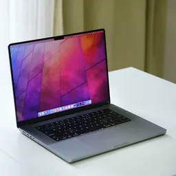</a> <b>#1</b> Space-grey laptop standing open on a white table beside a window laptop · photograph · target (member-normal) · Meets target clarity Rahul Chakraborty · <a href="https://unsplash.com/license">Unsplash License</a> Visual: approved · rights: approved 

Unresolved (2)
Screen shows a colourful default wallpaper  Laptop spans about 90% of the crop width, so side margins are small
</td>
<td width="33%" valign="top"><a href="standardized/computers/photo-unsplash-1634891392987-e91db6bf9557-standardized-v1.webp">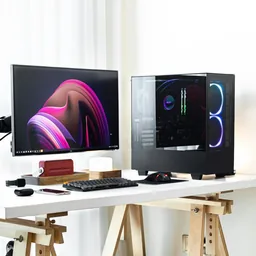</a> <b>#2</b> Desktop computer with monitor, glass-sided tower and keyboard on a white trestle desk desktop-computer · photograph · target (member-normal) · Meets target clarity I'M ZION · <a href="https://unsplash.com/license">Unsplash License</a> Visual: approved · rights: approved 

Unresolved (3)
The setup fills the upper half of the crop; the desk trestles fill the lower half  Tower shows coloured LED fan lighting  Monitor arm, small speaker, phone and other accessories on the desk; the camera rig at the far left is outside the crop
</td>
<td width="33%" valign="top"><a href="standardized/computers/photo-unsplash-1636485043041-e1d05b9f0662-standardized-v1.webp">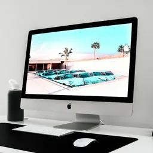</a> <b>#3</b> White all-in-one desktop computer with keyboard and mouse on a white desk desktop-computer · photograph · target (member-normal) · Meets target clarity Hillary Black · <a href="https://unsplash.com/license">Unsplash License</a> Visual: approved · rights: approved 

Unresolved (4)
All-in-one design: no separate tower, unlike the planned item  Keyboard and desk mat are cut by the crop edges  Small Apple logo on the monitor chin  Water bottle partly visible at the left edge
</td>
</tr>
<tr>
<td width="33%" valign="top"><a href="standardized/computers/photo-unsplash-1708765779373-f029c94ea8a1-standardized-v1.webp">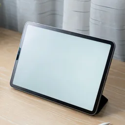</a> <b>#4</b> Tablet with a blank screen propped on a folio stand on a light wooden table tablet-computer · photograph · target (member-normal) · Meets target clarity Salvador Rios · <a href="https://unsplash.com/license">Unsplash License</a> Visual: approved · rights: approved 

Unresolved (2)
Blank white screen; at small size it could read as a picture frame  Headphones and a stylus lie just outside the crop
</td>
<td width="33%" valign="top"> <b>#5</b> Black tablet showing a green stock chart lying on a wooden desk tablet-computer · photograph · target (member-normal) · Meets target clarity Burak The Weekender · <a href="https://www.pexels.com/license/">Pexels License</a> Visual: approved · rights: approved 

Unresolved (3)
Overhead view rather than a side view  A stylus and a sheet of paper in the lower right are cut by the crop edge  Small top margin
</td>
<td width="33%" valign="top"> <b>#6</b> Light-blue vintage portable radio with a carrying handle on a plain yellow background radio · photograph · distractor (non-member) · Meets target clarity Pedro Miguel Aires · <a href="https://unsplash.com/license">Unsplash License</a> Visual: approved · rights: approved 

Unresolved (2)
Studio backdrop rather than a natural setting  Small script maker's name on the front
</td>
</tr>
<tr>
<td width="33%" valign="top"> <b>#7</b> Cream two-slice toaster with seeded bread on a wooden table toaster · photograph · distractor (non-member) · Meets target clarity Nicola Barts · <a href="https://www.pexels.com/license/">Pexels License</a> Visual: approved · rights: approved 

Unresolved (2)
Cream toaster against an off-white wall gives only moderate contrast on its right side  Right margin is small (about 50 px of the preview)
</td>
<td width="33%" valign="top"> <b>#8</b> Cream retro microwave oven with pots of herbs on top, on a kitchen worktop microwave-oven · photograph · distractor (non-member) · Meets target clarity cottonbro studio · <a href="https://www.pexels.com/license/">Pexels License</a> Visual: approved · rights: approved 

Unresolved (3)
Two herb pots stand on top of the oven  Small brand name on the door  Crop side is 620 px (above the 512 px minimum)
</td>
</tr>
</table>

### Manipulated

None yet.

### Final sets

None yet.

## musical-instruments

Suitable: 7 · awaiting review: 0 · rejected: 0 · standardised: 7 · manipulated: 0 · final sets: 0

### Suitable

Rights-verified and visually reviewed, by rank.

<table>
<tr>
<td width="33%" valign="top"> <b>#1</b> Violin and bow leaning against the back of a white wooden chair, with sheet music on the seat violin · photograph · target (member-normal) · Meets target clarity Ria Nurul Kamariah · <a href="https://unsplash.com/license">Unsplash License</a> Visual: approved · rights: approved 

Unresolved (2)
Bow leans alongside the violin; the share includes the bow  Chair and sheet music fill the lower part; the violin body is narrow within the crop
</td>
<td width="33%" valign="top"> <b>#2</b> Orange-red violin lying on weathered grey wooden decking violin · photograph · target (member-normal) · Meets target clarity Beth Rufener · <a href="https://unsplash.com/license">Unsplash License</a> Visual: approved · rights: approved 

Unresolved (2)
Overhead view  Diagonal board pattern behind the instrument
</td>
<td width="33%" valign="top"> <b>#3</b> Brass trumpet standing upright on its bell on a wooden floor in a living room trumpet · photograph · target (member-normal) · Meets target clarity PNW Production · <a href="https://www.pexels.com/license/">Pexels License</a> Visual: approved · rights: approved 

Unresolved (2)
Narrow upright object; the background (fireplace, plant, armchair) is moderately busy  Valves are small at 128 px
</td>
</tr>
<tr>
<td width="33%" valign="top"> <b>#4</b> Golden trumpet lying diagonally against a black background trumpet · photograph · target (member-normal) · Meets target clarity Volkan Engin · <a href="https://www.pexels.com/license/">Pexels License</a> Visual: approved · rights: approved 

Unresolved (2)
Dramatic studio lighting on a black background  Diagonal orientation; support not visible
</td>
<td width="33%" valign="top"> <b>#5</b> Red piano accordion standing on a round wooden stool with sheet music accordion · photograph · target (member-normal) · Meets target clarity Yan Krukau · <a href="https://www.pexels.com/license/">Pexels License</a> Visual: approved · rights: approved 

Unresolved (1)
Sheet music lies under the accordion
</td>
<td width="33%" valign="top"> <b>#6</b> Spade with a teal D-handle stuck upright in a grey sand heap spade · photograph · distractor (non-member) · Meets target clarity Jon Sailer · <a href="https://unsplash.com/license">Unsplash License</a> Visual: approved · rights: approved 

Unresolved (2)
Square-mouthed digging spade on a sand heap rather than in a garden bed  Top margin is about 46 px of the preview
</td>
</tr>
<tr>
<td width="33%" valign="top"> <b>#7</b> White paint roller lying on brown kraft paper with small paint splashes paint-roller · photograph · distractor (non-member) · Meets target clarity Nataliya Vaitkevich · <a href="https://www.pexels.com/license/">Pexels License</a> Visual: approved · rights: approved 

Unresolved (2)
High-angle view of an object lying flat  Small white paint splashes; a flower lies just outside the lower-right corner
</td>
</tr>
</table>

### Standardised

<table>
<tr>
<td width="33%" valign="top"> <b>#1</b> Violin and bow leaning against the back of a white wooden chair, with sheet music on the seat violin · photograph · target (member-normal) · Meets target clarity Ria Nurul Kamariah · <a href="https://unsplash.com/license">Unsplash License</a> Visual: approved · rights: approved 

Unresolved (2)
Bow leans alongside the violin; the share includes the bow  Chair and sheet music fill the lower part; the violin body is narrow within the crop
</td>
<td width="33%" valign="top"> <b>#2</b> Orange-red violin lying on weathered grey wooden decking violin · photograph · target (member-normal) · Meets target clarity Beth Rufener · <a href="https://unsplash.com/license">Unsplash License</a> Visual: approved · rights: approved 

Unresolved (2)
Overhead view  Diagonal board pattern behind the instrument
</td>
<td width="33%" valign="top"> <b>#3</b> Brass trumpet standing upright on its bell on a wooden floor in a living room trumpet · photograph · target (member-normal) · Meets target clarity PNW Production · <a href="https://www.pexels.com/license/">Pexels License</a> Visual: approved · rights: approved 

Unresolved (2)
Narrow upright object; the background (fireplace, plant, armchair) is moderately busy  Valves are small at 128 px
</td>
</tr>
<tr>
<td width="33%" valign="top"> <b>#4</b> Golden trumpet lying diagonally against a black background trumpet · photograph · target (member-normal) · Meets target clarity Volkan Engin · <a href="https://www.pexels.com/license/">Pexels License</a> Visual: approved · rights: approved 

Unresolved (2)
Dramatic studio lighting on a black background  Diagonal orientation; support not visible
</td>
<td width="33%" valign="top"> <b>#5</b> Red piano accordion standing on a round wooden stool with sheet music accordion · photograph · target (member-normal) · Meets target clarity Yan Krukau · <a href="https://www.pexels.com/license/">Pexels License</a> Visual: approved · rights: approved 

Unresolved (1)
Sheet music lies under the accordion
</td>
<td width="33%" valign="top"> <b>#6</b> Spade with a teal D-handle stuck upright in a grey sand heap spade · photograph · distractor (non-member) · Meets target clarity Jon Sailer · <a href="https://unsplash.com/license">Unsplash License</a> Visual: approved · rights: approved 

Unresolved (2)
Square-mouthed digging spade on a sand heap rather than in a garden bed  Top margin is about 46 px of the preview
</td>
</tr>
<tr>
<td width="33%" valign="top"> <b>#7</b> White paint roller lying on brown kraft paper with small paint splashes paint-roller · photograph · distractor (non-member) · Meets target clarity Nataliya Vaitkevich · <a href="https://www.pexels.com/license/">Pexels License</a> Visual: approved · rights: approved 

Unresolved (2)
High-angle view of an object lying flat  Small white paint splashes; a flower lies just outside the lower-right corner
</td>
</tr>
</table>

### Manipulated

None yet.

### Final sets

None yet.

## vehicles

Suitable: 7 · awaiting review: 0 · rejected: 0 · standardised: 7 · manipulated: 0 · final sets: 0

### Suitable

Rights-verified and visually reviewed, by rank.

<table>
<tr>
<td width="33%" valign="top"> <b>#1</b> Yellow school bus parked side-on in an open car park under a clear blue sky school-bus · photograph · target (member-normal) · Meets target clarity Renan Kamikoga · <a href="https://unsplash.com/license">Unsplash License</a> Visual: approved · rights: approved 

Unresolved (3)
Long, low vehicle: spans about 85% of the crop width but only about a quarter of its height  Small operator lettering along the side, illegible at tile size  Wooden shelter roof just behind the bus front
</td>
<td width="33%" valign="top"> <b>#2</b> Silver panel van parked side-on on frosty grass in a park panel-van · photograph · target (member-normal) · Meets target clarity Autotrader UK · <a href="https://unsplash.com/license">Unsplash License</a> Visual: approved · rights: approved 

Unresolved (3)
Silver body against pale frosty ground gives adequate rather than strong contrast  Small manufacturer badge on the front  Publisher is a company account (Autotrader UK); licence is still the standard Unsplash License
</td>
<td width="33%" valign="top"> <b>#3</b> Turquoise and white vintage camper van parked side-on at a kerb in front of a tree and an office building camper-van · photograph · target (member-normal) · Meets target clarity Noora Az · <a href="https://unsplash.com/license">Unsplash License</a> Visual: approved · rights: approved 

Unresolved (3)
Split-screen minibus shape could also be read as a small bus  Rear engine lid is open  Busy background (tree, building, signpost), although contrast is good
</td>
</tr>
<tr>
<td width="33%" valign="top"> <b>#4</b> Silver, blue and yellow electric passenger train on a tree-lined railway line passenger-train · photograph · target (member-normal) · Meets target clarity László Glatz · <a href="https://unsplash.com/license">Unsplash License</a> Visual: approved · rights: approved 

Unresolved (3)
Front three-quarter rather than side view (whole short unit visible)  Small route and unit lettering on the front  Overhead line masts and wires in the background
</td>
<td width="33%" valign="top"> <b>#5</b> Old wooden wardrobe with a mirrored door standing in a lavender field wardrobe · photograph · distractor (non-member) · Meets target clarity Jylia Boblei · <a href="https://www.pexels.com/license/">Pexels License</a> Visual: approved · rights: approved 

Unresolved (3)
Unusual outdoor setting for furniture  Mirror door reflects the surrounding field  Lavender bushes close around the base, though the base is visible
</td>
<td width="33%" valign="top"> <b>#6</b> Park bench with red-brown wooden slats and black cast-iron ends on a lawn in front of a dark hedge park-bench · photograph · distractor (non-member) · Meets target clarity Zoshua Colah · <a href="https://unsplash.com/license">Unsplash License</a> Visual: approved · rights: approved 

Unresolved (1)
Frontal view
</td>
</tr>
<tr>
<td width="33%" valign="top"> <b>#7</b> Stainless-steel side-by-side refrigerator with a water dispenser in a bright modern kitchen refrigerator · photograph · distractor (non-member) · Meets target clarity Lisa Anna · <a href="https://unsplash.com/license">Unsplash License</a> Visual: approved · rights: approved 

Unresolved (3)
Frontal view  Built in beside a tall white cabinet that reads as part of the same unit  Grey appliance against white and light grey surroundings: moderate contrast
</td>
</tr>
</table>

### Standardised

<table>
<tr>
<td width="33%" valign="top"> <b>#1</b> Yellow school bus parked side-on in an open car park under a clear blue sky school-bus · photograph · target (member-normal) · Meets target clarity Renan Kamikoga · <a href="https://unsplash.com/license">Unsplash License</a> Visual: approved · rights: approved 

Unresolved (3)
Long, low vehicle: spans about 85% of the crop width but only about a quarter of its height  Small operator lettering along the side, illegible at tile size  Wooden shelter roof just behind the bus front
</td>
<td width="33%" valign="top"> <b>#2</b> Silver panel van parked side-on on frosty grass in a park panel-van · photograph · target (member-normal) · Meets target clarity Autotrader UK · <a href="https://unsplash.com/license">Unsplash License</a> Visual: approved · rights: approved 

Unresolved (3)
Silver body against pale frosty ground gives adequate rather than strong contrast  Small manufacturer badge on the front  Publisher is a company account (Autotrader UK); licence is still the standard Unsplash License
</td>
<td width="33%" valign="top"> <b>#3</b> Turquoise and white vintage camper van parked side-on at a kerb in front of a tree and an office building camper-van · photograph · target (member-normal) · Meets target clarity Noora Az · <a href="https://unsplash.com/license">Unsplash License</a> Visual: approved · rights: approved 

Unresolved (3)
Split-screen minibus shape could also be read as a small bus  Rear engine lid is open  Busy background (tree, building, signpost), although contrast is good
</td>
</tr>
<tr>
<td width="33%" valign="top"> <b>#4</b> Silver, blue and yellow electric passenger train on a tree-lined railway line passenger-train · photograph · target (member-normal) · Meets target clarity László Glatz · <a href="https://unsplash.com/license">Unsplash License</a> Visual: approved · rights: approved 

Unresolved (3)
Front three-quarter rather than side view (whole short unit visible)  Small route and unit lettering on the front  Overhead line masts and wires in the background
</td>
<td width="33%" valign="top"> <b>#5</b> Old wooden wardrobe with a mirrored door standing in a lavender field wardrobe · photograph · distractor (non-member) · Meets target clarity Jylia Boblei · <a href="https://www.pexels.com/license/">Pexels License</a> Visual: approved · rights: approved 

Unresolved (3)
Unusual outdoor setting for furniture  Mirror door reflects the surrounding field  Lavender bushes close around the base, though the base is visible
</td>
<td width="33%" valign="top"> <b>#6</b> Park bench with red-brown wooden slats and black cast-iron ends on a lawn in front of a dark hedge park-bench · photograph · distractor (non-member) · Meets target clarity Zoshua Colah · <a href="https://unsplash.com/license">Unsplash License</a> Visual: approved · rights: approved 

Unresolved (1)
Frontal view
</td>
</tr>
<tr>
<td width="33%" valign="top"> <b>#7</b> Stainless-steel side-by-side refrigerator with a water dispenser in a bright modern kitchen refrigerator · photograph · distractor (non-member) · Meets target clarity Lisa Anna · <a href="https://unsplash.com/license">Unsplash License</a> Visual: approved · rights: approved 

Unresolved (3)
Frontal view  Built in beside a tall white cabinet that reads as part of the same unit  Grey appliance against white and light grey surroundings: moderate contrast
</td>
</tr>
</table>

### Manipulated

None yet.

### Final sets

None yet.

## hats

Suitable: 6 · awaiting review: 0 · rejected: 0 · standardised: 6 · manipulated: 0 · final sets: 0

### Suitable

Rights-verified and visually reviewed, by rank.

<table>
<tr>
<td width="33%" valign="top"> <b>#1</b> Black bowler hat with a grey band resting on cobblestones bowler-hat · photograph · target (member-normal) · Meets target clarity nicola dowie · <a href="https://unsplash.com/license">Unsplash License</a> Visual: approved · rights: approved 

Unresolved (2)
Black hat on dark grey cobbles: adequate rather than strong contrast  Scrap of paper just behind the brim on the right
</td>
<td width="33%" valign="top"> <b>#2</b> Yellow baseball cap on a plain white background baseball-cap · photograph · target (member-normal) · Meets target clarity sonu kumar · <a href="https://unsplash.com/license">Unsplash License</a> Visual: approved · rights: approved 

Unresolved (1)
Studio white background rather than an everyday setting
</td>
<td width="33%" valign="top"> <b>#3</b> White baseball cap with a small embroidered red heart on a dark round table baseball-cap · photograph · target (member-normal) · Meets target clarity Katja Ano · <a href="https://unsplash.com/license">Unsplash License</a> Visual: approved · rights: approved 

Unresolved (2)
Front three-quarter view  Small embroidered red heart motif on the crown
</td>
</tr>
<tr>
<td width="33%" valign="top"> <b>#4</b> Pink ribbed knitted beanie with a fur pompom on top of a wooden fence post in a field beanie · photograph · target (member-normal) · Meets target clarity Lucas van Oort · <a href="https://unsplash.com/license">Unsplash License</a> Visual: approved · rights: approved 

Unresolved (1)
Hat slouches over the post rather than keeping the shape it has when worn
</td>
<td width="33%" valign="top"> <b>#5</b> Blue porcelain teacup with a floral interior on a matching saucer, on a round wooden table teacup · photograph · distractor (non-member) · Meets target clarity Caroline Badran · <a href="https://unsplash.com/license">Unsplash License</a> Visual: approved · rights: approved 

Unresolved (2)
Seen from a fairly high angle  Cup and saucer together
</td>
<td width="33%" valign="top"> <b>#6</b> Terracotta plant pot with dried plants on a brick ledge beside a whitewashed wall plant-pot · photograph · distractor (non-member) · Meets target clarity Marija Zaric · <a href="https://unsplash.com/license">Unsplash License</a> Visual: approved · rights: approved 

Unresolved (2)
Dried plant stems spread to the crop edges (the pot itself is whole)  Dark pipe and ivy in the upper background
</td>
</tr>
</table>

### Standardised

<table>
<tr>
<td width="33%" valign="top"> <b>#1</b> Black bowler hat with a grey band resting on cobblestones bowler-hat · photograph · target (member-normal) · Meets target clarity nicola dowie · <a href="https://unsplash.com/license">Unsplash License</a> Visual: approved · rights: approved 

Unresolved (2)
Black hat on dark grey cobbles: adequate rather than strong contrast  Scrap of paper just behind the brim on the right
</td>
<td width="33%" valign="top"> <b>#2</b> Yellow baseball cap on a plain white background baseball-cap · photograph · target (member-normal) · Meets target clarity sonu kumar · <a href="https://unsplash.com/license">Unsplash License</a> Visual: approved · rights: approved 

Unresolved (1)
Studio white background rather than an everyday setting
</td>
<td width="33%" valign="top"> <b>#3</b> White baseball cap with a small embroidered red heart on a dark round table baseball-cap · photograph · target (member-normal) · Meets target clarity Katja Ano · <a href="https://unsplash.com/license">Unsplash License</a> Visual: approved · rights: approved 

Unresolved (2)
Front three-quarter view  Small embroidered red heart motif on the crown
</td>
</tr>
<tr>
<td width="33%" valign="top"> <b>#4</b> Pink ribbed knitted beanie with a fur pompom on top of a wooden fence post in a field beanie · photograph · target (member-normal) · Meets target clarity Lucas van Oort · <a href="https://unsplash.com/license">Unsplash License</a> Visual: approved · rights: approved 

Unresolved (1)
Hat slouches over the post rather than keeping the shape it has when worn
</td>
<td width="33%" valign="top"> <b>#5</b> Blue porcelain teacup with a floral interior on a matching saucer, on a round wooden table teacup · photograph · distractor (non-member) · Meets target clarity Caroline Badran · <a href="https://unsplash.com/license">Unsplash License</a> Visual: approved · rights: approved 

Unresolved (2)
Seen from a fairly high angle  Cup and saucer together
</td>
<td width="33%" valign="top"> <b>#6</b> Terracotta plant pot with dried plants on a brick ledge beside a whitewashed wall plant-pot · photograph · distractor (non-member) · Meets target clarity Marija Zaric · <a href="https://unsplash.com/license">Unsplash License</a> Visual: approved · rights: approved 

Unresolved (2)
Dried plant stems spread to the crop edges (the pot itself is whole)  Dark pipe and ivy in the upper background
</td>
</tr>
</table>

### Manipulated

None yet.

### Final sets

None yet.

## bridges

Suitable: 9 · awaiting review: 0 · rejected: 0 · standardised: 9 · manipulated: 0 · final sets: 0

### Suitable

Rights-verified and visually reviewed, by rank.

<table>
<tr>
<td width="33%" valign="top"> <b>#1</b> Grey stone packhorse arch bridge over a dark river among trees under a blue sky stone-arch-footbridge · photograph · target (member-normal) · Meets target clarity Welmoed Wigarda · <a href="https://unsplash.com/license">Unsplash License</a> Visual: approved · rights: approved 

Unresolved (2)
Bridge spans about 95% of the crop width, so the side margins are tight  Abutments merge into rocky banks
</td>
<td width="33%" valign="top"> <b>#2</b> Weathered stone arch bridge over a calm river beside a grassy bank and a cliff stone-arch-footbridge · photograph · target (member-normal) · Meets target clarity GOETZ Jean-Pierre · <a href="https://unsplash.com/license">Unsplash License</a> Visual: approved · rights: approved 

Unresolved (2)
Bridge spans about 92% of the crop width  Part of an old stone wall appears in the top-left corner
</td>
<td width="33%" valign="top"> <b>#3</b> Suspension bridge with two stone towers and hanging cables above a wooded gorge suspension-bridge · photograph · target (member-normal) · Meets target clarity Korng Sok · <a href="https://unsplash.com/license">Unsplash License</a> Visual: approved · rights: approved 

Unresolved (3)
Road suspension bridge rather than a footbridge; well-known landmark (Clifton Suspension Bridge)  Tower bases partly screened by trees  Left back-stay cables run close to the left edge
</td>
</tr>
<tr>
<td width="33%" valign="top"> <b>#4</b> Small dark-brown wooden arched footbridge on a garden path with shrubs behind wooden-footbridge · photograph · target (member-normal) · Meets target clarity Julia Filirovska · <a href="https://www.pexels.com/license/">Pexels License</a> Visual: approved · rights: approved 

Unresolved (1)
A grey lamp post rises behind the middle of the bridge
</td>
<td width="33%" valign="top"> <b>#5</b> Single fallen log lying across a rushing river between forested banks fallen-tree-log · photograph · borderline (member-debatable) · Meets target clarity Veronica Dudarev · <a href="https://unsplash.com/license">Unsplash License</a> Visual: approved · rights: approved 

Unresolved (3)
Marginal: the log is thin and reads as a horizontal line at 128 px  Dark forest background  A rope or cable is attached at the right end; no better alternative found
</td>
<td width="33%" valign="top"> <b>#6</b> Row of large round concrete stepping stones crossing a calm stream to a grassy bank stepping-stones · photograph · borderline (member-debatable) · Meets target clarity Vincere L · <a href="https://www.pexels.com/license/">Pexels License</a> Visual: approved · rights: approved 

Unresolved (2)
Nearest stone is cut by the bottom edge of the photograph  Perspective view along the crossing
</td>
</tr>
<tr>
<td width="33%" valign="top"> <b>#7</b> Stone-faced railway tunnel portal with a white arch and dark interior tunnel-portal · photograph · distractor (non-member) · Meets target clarity Attila Pál · <a href="https://unsplash.com/license">Unsplash License</a> Visual: approved · rights: approved 

Unresolved (2)
Small white sign at the right edge  Very dark interior
</td>
<td width="33%" valign="top"> <b>#8</b> Wooden staircase with metal handrails climbing a sand dune to a viewing platform outdoor-staircase · photograph · distractor (non-member) · Meets target clarity Viktorya Sergeeva · <a href="https://www.pexels.com/license/">Pexels License</a> Visual: approved · rights: approved 

Unresolved (1)
Thin handrails at 128 px
</td>
<td width="33%" valign="top"> <b>#9</b> Empty railway station platform with a yellow canopy, benches and adjacent tracks railway-platform · photograph · distractor (non-member) · Meets target clarity Maria Vasiliki Kassou · <a href="https://unsplash.com/license">Unsplash License</a> Visual: approved · rights: approved 

Unresolved (2)
End-on perspective view; the platform runs out of frame (inherent to the subject)  Benches and canopy pillars are visible
</td>
</tr>
</table>

### Standardised

<table>
<tr>
<td width="33%" valign="top"> <b>#1</b> Grey stone packhorse arch bridge over a dark river among trees under a blue sky stone-arch-footbridge · photograph · target (member-normal) · Meets target clarity Welmoed Wigarda · <a href="https://unsplash.com/license">Unsplash License</a> Visual: approved · rights: approved 

Unresolved (2)
Bridge spans about 95% of the crop width, so the side margins are tight  Abutments merge into rocky banks
</td>
<td width="33%" valign="top"> <b>#2</b> Weathered stone arch bridge over a calm river beside a grassy bank and a cliff stone-arch-footbridge · photograph · target (member-normal) · Meets target clarity GOETZ Jean-Pierre · <a href="https://unsplash.com/license">Unsplash License</a> Visual: approved · rights: approved 

Unresolved (2)
Bridge spans about 92% of the crop width  Part of an old stone wall appears in the top-left corner
</td>
<td width="33%" valign="top"> <b>#3</b> Suspension bridge with two stone towers and hanging cables above a wooded gorge suspension-bridge · photograph · target (member-normal) · Meets target clarity Korng Sok · <a href="https://unsplash.com/license">Unsplash License</a> Visual: approved · rights: approved 

Unresolved (3)
Road suspension bridge rather than a footbridge; well-known landmark (Clifton Suspension Bridge)  Tower bases partly screened by trees  Left back-stay cables run close to the left edge
</td>
</tr>
<tr>
<td width="33%" valign="top"> <b>#4</b> Small dark-brown wooden arched footbridge on a garden path with shrubs behind wooden-footbridge · photograph · target (member-normal) · Meets target clarity Julia Filirovska · <a href="https://www.pexels.com/license/">Pexels License</a> Visual: approved · rights: approved 

Unresolved (1)
A grey lamp post rises behind the middle of the bridge
</td>
<td width="33%" valign="top"> <b>#5</b> Single fallen log lying across a rushing river between forested banks fallen-tree-log · photograph · borderline (member-debatable) · Meets target clarity Veronica Dudarev · <a href="https://unsplash.com/license">Unsplash License</a> Visual: approved · rights: approved 

Unresolved (3)
Marginal: the log is thin and reads as a horizontal line at 128 px  Dark forest background  A rope or cable is attached at the right end; no better alternative found
</td>
<td width="33%" valign="top"> <b>#6</b> Row of large round concrete stepping stones crossing a calm stream to a grassy bank stepping-stones · photograph · borderline (member-debatable) · Meets target clarity Vincere L · <a href="https://www.pexels.com/license/">Pexels License</a> Visual: approved · rights: approved 

Unresolved (2)
Nearest stone is cut by the bottom edge of the photograph  Perspective view along the crossing
</td>
</tr>
<tr>
<td width="33%" valign="top"> <b>#7</b> Stone-faced railway tunnel portal with a white arch and dark interior tunnel-portal · photograph · distractor (non-member) · Meets target clarity Attila Pál · <a href="https://unsplash.com/license">Unsplash License</a> Visual: approved · rights: approved 

Unresolved (2)
Small white sign at the right edge  Very dark interior
</td>
<td width="33%" valign="top"> <b>#8</b> Wooden staircase with metal handrails climbing a sand dune to a viewing platform outdoor-staircase · photograph · distractor (non-member) · Meets target clarity Viktorya Sergeeva · <a href="https://www.pexels.com/license/">Pexels License</a> Visual: approved · rights: approved 

Unresolved (1)
Thin handrails at 128 px
</td>
<td width="33%" valign="top"> <b>#9</b> Empty railway station platform with a yellow canopy, benches and adjacent tracks railway-platform · photograph · distractor (non-member) · Meets target clarity Maria Vasiliki Kassou · <a href="https://unsplash.com/license">Unsplash License</a> Visual: approved · rights: approved 

Unresolved (2)
End-on perspective view; the platform runs out of frame (inherent to the subject)  Benches and canopy pillars are visible
</td>
</tr>
</table>

### Manipulated

None yet.

### Final sets

None yet.

## sandwiches

Suitable: 9 · awaiting review: 0 · rejected: 0 · standardised: 9 · manipulated: 0 · final sets: 0

### Suitable

Rights-verified and visually reviewed, by rank.

<table>
<tr>
<td width="33%" valign="top"> <b>#1</b> Toasted white-bread cheese sandwich on a black plate on a wooden table cheese-sandwich · photograph · target (member-normal) · Meets target clarity You Le · <a href="https://unsplash.com/license">Unsplash License</a> Visual: approved · rights: approved 

Unresolved (1)
Half a lime is visible at the lower-left corner
</td>
<td width="33%" valign="top"> <b>#2</b> Triple-layer club sandwich triangle held with a cocktail stick on a white plate club-sandwich · photograph · target (member-normal) · Meets target clarity Suea Sivilaisith · <a href="https://unsplash.com/license">Unsplash License</a> Visual: approved · rights: approved 

Unresolved (2)
Tight right margin; fork and napkin at the right edge  Blurred glass behind
</td>
<td width="33%" valign="top"> <b>#3</b> Crusty baguette sandwich with ham and tomato on a grey plate baguette-sandwich · photograph · target (member-normal) · Meets target clarity Farhad Ibrahimzade · <a href="https://unsplash.com/license">Unsplash License</a> Visual: approved · rights: approved 

Unresolved (3)
Short baguette section that could be read as a ciabatta roll  Blurred bottles in the background  Most full-length baguette photographs were too long for a square crop
</td>
</tr>
<tr>
<td width="33%" valign="top"> <b>#4</b> Hot dog with relish and a pickle spear in a paper tray on a blue background hot-dog · photograph · borderline (member-debatable) · Meets target clarity Drew Dempsey · <a href="https://unsplash.com/license">Unsplash License</a> Visual: approved · rights: approved 

Unresolved (2)
Studio backdrop  Tray is cut at the left edge
</td>
<td width="33%" valign="top"> <b>#5</b> Baked calzone on a round wooden board with salad leaves calzone · photograph · borderline (member-debatable) · Meets target clarity bahareh moradian · <a href="https://unsplash.com/license">Unsplash License</a> Visual: approved · rights: approved 

Unresolved (1)
Pizza box partly visible behind
</td>
<td width="33%" valign="top"> <b>#6</b> Beef burger wrapped in iceberg lettuce instead of a bun, on a green plate lettuce-wrapped-burger · photograph · borderline (member-debatable) · Meets target clarity Barcello's fusion · <a href="https://unsplash.com/license">Unsplash License</a> Visual: approved · rights: approved 

Unresolved (3)
Wooden pick carries small printed text  Dark background  Restaurant account (Barcello's) as publisher
</td>
</tr>
<tr>
<td width="33%" valign="top"> <b>#7</b> Margherita pizza with tomatoes and basil on a dark floured surface pizza · photograph · distractor (non-member) · Meets target clarity Inna Gurina · <a href="https://unsplash.com/license">Unsplash License</a> Visual: approved · rights: approved 

Unresolved (1)
Overhead view (a flat food, but not a side view)
</td>
<td width="33%" valign="top"> <b>#8</b> Orange soup with herbs in a white bowl on a blue-grey surface bowl-of-soup · photograph · distractor (non-member) · Meets target clarity Hanna Balan · <a href="https://unsplash.com/license">Unsplash License</a> Visual: approved · rights: approved 

Unresolved (2)
Gold spoon handle at the lower right  Striped cloth behind
</td>
<td width="33%" valign="top"> <b>#9</b> Pasta salad with tuna, cherry tomatoes and peppers in a white bowl on white pasta-salad · photograph · distractor (non-member) · Meets target clarity Eiliv Aceron · <a href="https://unsplash.com/license">Unsplash License</a> Visual: approved · rights: approved 

Unresolved (2)
Overhead studio view on plain white  No three-quarter pasta salad photograph fitted the square crop without cutting the bowl
</td>
</tr>
</table>

### Standardised

<table>
<tr>
<td width="33%" valign="top"> <b>#1</b> Toasted white-bread cheese sandwich on a black plate on a wooden table cheese-sandwich · photograph · target (member-normal) · Meets target clarity You Le · <a href="https://unsplash.com/license">Unsplash License</a> Visual: approved · rights: approved 

Unresolved (1)
Half a lime is visible at the lower-left corner
</td>
<td width="33%" valign="top"> <b>#2</b> Triple-layer club sandwich triangle held with a cocktail stick on a white plate club-sandwich · photograph · target (member-normal) · Meets target clarity Suea Sivilaisith · <a href="https://unsplash.com/license">Unsplash License</a> Visual: approved · rights: approved 

Unresolved (2)
Tight right margin; fork and napkin at the right edge  Blurred glass behind
</td>
<td width="33%" valign="top"> <b>#3</b> Crusty baguette sandwich with ham and tomato on a grey plate baguette-sandwich · photograph · target (member-normal) · Meets target clarity Farhad Ibrahimzade · <a href="https://unsplash.com/license">Unsplash License</a> Visual: approved · rights: approved 

Unresolved (3)
Short baguette section that could be read as a ciabatta roll  Blurred bottles in the background  Most full-length baguette photographs were too long for a square crop
</td>
</tr>
<tr>
<td width="33%" valign="top"> <b>#4</b> Hot dog with relish and a pickle spear in a paper tray on a blue background hot-dog · photograph · borderline (member-debatable) · Meets target clarity Drew Dempsey · <a href="https://unsplash.com/license">Unsplash License</a> Visual: approved · rights: approved 

Unresolved (2)
Studio backdrop  Tray is cut at the left edge
</td>
<td width="33%" valign="top"> <b>#5</b> Baked calzone on a round wooden board with salad leaves calzone · photograph · borderline (member-debatable) · Meets target clarity bahareh moradian · <a href="https://unsplash.com/license">Unsplash License</a> Visual: approved · rights: approved 

Unresolved (1)
Pizza box partly visible behind
</td>
<td width="33%" valign="top"> <b>#6</b> Beef burger wrapped in iceberg lettuce instead of a bun, on a green plate lettuce-wrapped-burger · photograph · borderline (member-debatable) · Meets target clarity Barcello's fusion · <a href="https://unsplash.com/license">Unsplash License</a> Visual: approved · rights: approved 

Unresolved (3)
Wooden pick carries small printed text  Dark background  Restaurant account (Barcello's) as publisher
</td>
</tr>
<tr>
<td width="33%" valign="top"> <b>#7</b> Margherita pizza with tomatoes and basil on a dark floured surface pizza · photograph · distractor (non-member) · Meets target clarity Inna Gurina · <a href="https://unsplash.com/license">Unsplash License</a> Visual: approved · rights: approved 

Unresolved (1)
Overhead view (a flat food, but not a side view)
</td>
<td width="33%" valign="top"> <b>#8</b> Orange soup with herbs in a white bowl on a blue-grey surface bowl-of-soup · photograph · distractor (non-member) · Meets target clarity Hanna Balan · <a href="https://unsplash.com/license">Unsplash License</a> Visual: approved · rights: approved 

Unresolved (2)
Gold spoon handle at the lower right  Striped cloth behind
</td>
<td width="33%" valign="top"> <b>#9</b> Pasta salad with tuna, cherry tomatoes and peppers in a white bowl on white pasta-salad · photograph · distractor (non-member) · Meets target clarity Eiliv Aceron · <a href="https://unsplash.com/license">Unsplash License</a> Visual: approved · rights: approved 

Unresolved (2)
Overhead studio view on plain white  No three-quarter pasta salad photograph fitted the square crop without cutting the bowl
</td>
</tr>
</table>

### Manipulated

None yet.

### Final sets

None yet.
