# Stimulus gallery

*Generated from [catalogue.json](catalogue.json) and the stage manifests by `npm run gallery:collection`; do not edit by hand. The catalogue remains the record.*

Linked photographs are shown from their source sites and keep their recorded licences; they may stop displaying if a source link expires. Click an image for its publisher page or full-size file. See [README.md](README.md) for the levels.

## bicycles

Suitable: 31 · awaiting review: 0 · rejected: 21 · standardised: 31 · manipulated: 0 · final sets: 1

### Suitable

Rights-verified and visually reviewed, by rank.

<table>
<tr>
<td width="33%" valign="top"> <b>#1</b> Black track bicycle against a white wall bicycle · photograph · target (member-normal) · Meets target clarity Alonso Talbert · <a href="https://unsplash.com/license">Unsplash License</a> Visual: approved · rights: approved</td>
<td width="33%" valign="top"> <b>#2</b> White road bicycle against a teal wooden wall bicycle · photograph · target (member-normal) · Meets target clarity Carl Nenzen Loven · <a href="https://unsplash.com/license">Unsplash License</a> Visual: approved · rights: approved</td>
<td width="33%" valign="top"> <b>#3</b> Blue motor scooter beside a white wall motor-scooter · photograph · distractor (non-member) · Meets target clarity Mathias Reding · <a href="https://www.pexels.com/license/">Pexels License</a> Visual: approved · rights: approved</td>
</tr>
<tr>
<td width="33%" valign="top"> <b>#4</b> Pink step-through bicycle before dark foliage bicycle · photograph · target (member-normal) · Meets target clarity Kadir Kvs · <a href="https://unsplash.com/license">Unsplash License</a> Visual: approved · rights: approved</td>
<td width="33%" valign="top"> <b>#5</b> Light blue bicycle with a wooden crate against a white wall bicycle · photograph · target (member-normal) · Meets target clarity Kris Tian · <a href="https://unsplash.com/license">Unsplash License</a> Visual: approved · rights: approved</td>
<td width="33%" valign="top"> <b>#6</b> Red city bicycle against a light wall bicycle · photograph · target (member-normal) · Meets target clarity Valentino Sacco · <a href="https://unsplash.com/license">Unsplash License</a> Visual: approved · rights: approved</td>
</tr>
<tr>
<td width="33%" valign="top"> <b>#7</b> Lavender bicycle with orange tyres against a white brick wall bicycle · photograph · target (member-normal) · Meets target clarity Tiffany Nutt · <a href="https://unsplash.com/license">Unsplash License</a> Visual: approved · rights: approved</td>
<td width="33%" valign="top"> <b>#8</b> Black cruiser motorcycle against a stone building motorcycle · photograph · distractor (non-member) · Meets target clarity Iván Antonio · <a href="https://unsplash.com/license">Unsplash License</a> Visual: approved · rights: approved</td>
<td width="33%" valign="top"> <b>#9</b> White road bicycle against black and red facade panels bicycle · photograph · target (member-normal) · Meets target clarity streetwaw_ · <a href="https://unsplash.com/license">Unsplash License</a> Visual: approved · rights: approved</td>
</tr>
<tr>
<td width="33%" valign="top"> <b>#10</b> Cream bicycle with a rear carrier bicycle · photograph · target (member-normal) · Meets target clarity Waldemar Brandt · <a href="https://unsplash.com/license">Unsplash License</a> Visual: approved · rights: approved</td>
<td width="33%" valign="top"> <b>#11</b> Black city bicycle against a yellow house bicycle · photograph · target (member-normal) · Meets target clarity Razvan Mirel · <a href="https://unsplash.com/license">Unsplash License</a> Visual: approved · rights: approved</td>
<td width="33%" valign="top"> <b>#12</b> Skateboard resting on pavement skateboard · photograph · distractor (non-member) · Meets target clarity Pict4life · <a href="https://unsplash.com/license">Unsplash License</a> Visual: approved · rights: approved</td>
</tr>
<tr>
<td width="33%" valign="top"> <b>#13</b> Orange and teal mountain bike on grass by driftwood bicycle · photograph · target (member-normal) · Meets target clarity Yasin Aydın · <a href="https://www.pexels.com/license/">Pexels License</a> Visual: approved · rights: approved</td>
<td width="33%" valign="top"> <b>#14</b> Yellow cruiser bicycle with a flower basket against a wooden door bicycle · photograph · target (member-normal) · Meets target clarity Mehmet Guzel · <a href="https://unsplash.com/license">Unsplash License</a> Visual: approved · rights: approved</td>
<td width="33%" valign="top"> <b>#15</b> Copper city bicycle leaning against a street pole bicycle · photograph · target (member-normal) · Meets target clarity Volker Thimm · <a href="https://www.pexels.com/license/">Pexels License</a> Visual: approved · rights: approved</td>
</tr>
<tr>
<td width="33%" valign="top"> <b>#16</b> Small red car parked before a hedge car · photograph · distractor (non-member) · Meets target clarity CrowN · <a href="https://unsplash.com/license">Unsplash License</a> Visual: approved · rights: approved</td>
<td width="33%" valign="top"> <b>#17</b> Red vintage bicycle against a blue clapboard wall bicycle · photograph · target (member-normal) · Meets target clarity Jason Gooljar · <a href="https://unsplash.com/license">Unsplash License</a> Visual: approved · rights: approved</td>
<td width="33%" valign="top"> <b>#18</b> Turquoise bicycle with a crate against a dune fence bicycle · photograph · target (member-normal) · Meets target clarity Soumia Sol · <a href="https://www.pexels.com/license/">Pexels License</a> Visual: approved · rights: approved</td>
</tr>
<tr>
<td width="33%" valign="top"> <b>#19</b> Teal city bicycle against a canal-bridge railing bicycle · photograph · target (member-normal) · Meets target clarity Dmitrii E. · <a href="https://unsplash.com/license">Unsplash License</a> Visual: approved · rights: approved</td>
<td width="33%" valign="top"> <b>#20</b> Pale green bicycle with a basket beside a wooden door bicycle · photograph · target (member-normal) · Meets target clarity Thomas P · <a href="https://www.pexels.com/license/">Pexels License</a> Visual: approved · rights: approved</td>
<td width="33%" valign="top"> <b>#21</b> Black roadster bicycle with a front basket against a white wall bicycle · photograph · target (member-normal) · Meets target clarity Naura Ra · <a href="https://unsplash.com/license">Unsplash License</a> Visual: approved · rights: approved</td>
</tr>
<tr>
<td width="33%" valign="top"> <b>#22</b> Navy road bicycle against a two-tone wall bicycle · photograph · target (member-normal) · Meets target clarity Zoltan Tasi · <a href="https://unsplash.com/license">Unsplash License</a> Visual: approved · rights: approved</td>
<td width="33%" valign="top"> <b>#23</b> Copper fixed-gear bicycle against a white wall bicycle · photograph · target (member-normal) · Meets target clarity Markus Spiske · <a href="https://unsplash.com/license">Unsplash License</a> Visual: approved · rights: approved</td>
<td width="33%" valign="top"> <b>#24</b> Black city bicycle with a basket against a grey wall bicycle · photograph · target (member-normal) · Meets target clarity Abhishek Ravi · <a href="https://unsplash.com/license">Unsplash License</a> Visual: approved · rights: approved</td>
</tr>
<tr>
<td width="33%" valign="top"> <b>#25</b> Black fixed-gear bicycle against a grey concrete wall bicycle · photograph · target (member-normal) · Meets target clarity Howard Bouchevereau · <a href="https://unsplash.com/license">Unsplash License</a> Visual: approved · rights: approved</td>
<td width="33%" valign="top"> <b>#26</b> Light-blue touring bicycle against a dry hillside bicycle · photograph · target (member-normal) · Meets target clarity cyclotourist · <a href="https://creativecommons.org/licenses/by-nc/2.0/">CC BY-NC 2.0</a> Visual: approved · rights: approved</td>
<td width="33%" valign="top"> <b>#27</b> Copper-orange custom cruiser bicycle on open asphalt bicycle · photograph · target (member-normal) · Meets target clarity Sidral Mundet · <a href="https://unsplash.com/license">Unsplash License</a> Visual: approved · rights: approved 

Unresolved (1)
Custom low-rider cruiser with long swept handlebars and a stretched frame: clearly a bicycle, but a less typical shape; confirm it reads as a normal member rather than a borderline item when composing a set.
</td>
</tr>
<tr>
<td width="33%" valign="top"> <b>#28</b> Yellow roadster bicycle between lavender rows bicycle · photograph · target (member-normal) · Meets target clarity Gunay Topaloglu · <a href="https://unsplash.com/license">Unsplash License</a> Visual: approved · rights: approved 

Unresolved (1)
A few out-of-focus lavender stems at the lower left touch the front tyre; they do not hide any defining part. Reject if the owner reads this as an obstruction.
</td>
<td width="33%" valign="top"> <b>#29</b> Silver-beige city bicycle with a basket by a lavender border bicycle · photograph · target (member-normal) · Meets target clarity Teodor Buhl · <a href="https://www.pexels.com/license/">Pexels License</a> Visual: approved · rights: approved 

Unresolved (1)
The front tyre comes within about 1–2% of the lower crop edge because the preview leaves no more room; nothing is cut.
</td>
<td width="33%" valign="top"> <b>#30</b> Black hybrid bicycle on a tree-lined park road bicycle · photograph · target (member-normal) · Meets target clarity Ionut Zamfir · <a href="https://unsplash.com/license">Unsplash License</a> Visual: approved · rights: approved</td>
</tr>
<tr>
<td width="33%" valign="top"> <b>#31</b> Black vintage roadster bicycle on a park lawn bicycle · photograph · target (member-normal) · Meets target clarity Alex Plesovskich · <a href="https://unsplash.com/license">Unsplash License</a> Visual: approved · rights: approved 

Unresolved (1)
The dark frame is partly seen against green grass; it remains clear at 128 px because the frame is much darker than the lawn.
</td>
</tr>
</table>

Rejected photographs (21), not shown
<ul><li><a href="https://pixabay.com/photos/bike-riverside-guangzhou-lock-1128840/">White folding bicycle against a wall</a>: Only nearly meets the target clarity standard: about 72% of the crop, white frame against a pale wall, empty foreground.</li><li><a href="https://unsplash.com/photos/red-and-black-bicycle-leaning-on-white-metal-fence-05w655MmFx8">Red bicycle against a grey metal wall</a>: Only nearly meets the target clarity standard: about 67% of the crop, the lower limit.</li><li><a href="https://www.pexels.com/photo/road-bicycle-by-tree-by-road-14682786/">Road bicycle leaning against a tree</a>: Below the target clarity standard: the tree trunk overlaps the frame, the silver frame has low contrast against the grey road, and the bicycle spans only about 62% of the crop.</li><li><a href="https://unsplash.com/photos/blue-step-through-bicycle-park-beside-of-red-bench-xmGkzY--Fgg">Blue city bicycle beside a red bench</a>: Below the target clarity standard: the bicycle spans only about 62% of the crop above a large empty foreground; the 600 px crop cannot be tightened without upscaling.</li><li><a href="https://unsplash.com/photos/black-and-green-full-suspension-bike-1lE8ivHMQN8">Small green bicycle by a brick wall</a>: Only nearly meets the target clarity standard: about 70% of the crop, with a dark doorway at the edge.</li><li><a href="https://unsplash.com/photos/a-motorcycle-parked-in-front-of-a-brick-wall-xzEbZjbS4cA">Motorcycle parked in front of a brick wall</a>: Only nearly meets the target clarity standard: front three-quarter view of about 45 degrees, beyond the 30-degree limit.</li><li><a href="https://thumb.pexafy.com/019e2013-2936-7e0f-be55-db92f55205ac/1280w.jpg?s=1f6f3afccc0b02a7">Black folding bicycle beside a drainpipe</a>: Below the target clarity standard: a drainpipe crosses the bicycle, and the black frame has little contrast against the dark ground.</li><li><a href="https://thumb.pexafy.com/019e16d6-9e99-74b9-b724-edfbe7a4c8b9/1280w.jpg?s=8a5543a2b20c6bfc">Red-and-white bicycle against a pale wall</a>: Below the target clarity standard: close, steep front three-quarter view.</li><li><a href="https://www.pexels.com/photo/bike-attached-to-a-fence-12322815">Bicycle leaning against a metal fence</a>: Below the target clarity standard: near-frontal steep view; the dark bicycle has little contrast against the dark ribbed fence.</li><li><a href="https://unsplash.com/photos/a-bicycle-is-parked-next-to-a-building-2baxeyMG-eM">Silver bicycle beside a pastel wall</a>: Below the target clarity standard: silver bicycle with low contrast against a grey and pastel wall, partly shaded, off-centre and about 65% of the crop.</li><li><a href="https://www.pexels.com/photo/a-bicycle-standing-on-the-side-of-the-pavement-19172412/">Red road bicycle by a timber railing</a>: Below the target clarity standard: steep three-quarter view, with the railing and foliage behind the frame.</li><li><a href="https://unsplash.com/photos/green-female-beach-cruiser-bike-leaning-on-wall-GmMTa8Mjngg">Green city bicycle against a stone wall</a>: Below the target clarity standard: close, steeply oblique rear view that foreshortens the bicycle.</li><li><a href="https://thumb.pexafy.com/019e144a-c76c-7a96-b721-6646821bfd2e/1280w.jpg?s=8fed9a0395c74d36">Red bicycle beside a stone building</a>: Only nearly meets the target clarity standard: rear three-quarter view of about 45 degrees, beyond the 30-degree limit.</li><li><a href="https://pixabay.com/photos/cycling-motivation-like-thinking-6094699/">Turquoise road bicycle against a wooden fence</a>: Below the target clarity standard: the bicycle spans only about 47% of the crop, in a three-quarter view against fence and field detail.</li><li><a href="https://www.pexels.com/photo/bicycle-leaning-on-a-brick-wall-18999320">Blue bicycle with a yellow front fork</a>: Below the target clarity standard: the bicycle spans only about 60% of the crop above a large paving foreground.</li><li><a href="https://www.pexels.com/photo/vintage-vehicle-next-to-a-cafeteria-13503005">Mint-coloured microcar outside a café</a>: Only nearly meets the target clarity standard: busy cafe frontage behind the car, about 70% of the crop.</li><li><a href="https://www.pexels.com/photo/vintage-bicycle-resting-against-weathered-wall-36095859/">Silver city bicycle against a weathered wall</a>: Below the target clarity standard: silver bicycle with low contrast against a grey-olive wall, about 62% of the crop.</li><li><a href="https://www.pexels.com/photo/bicycle-on-pavement-near-wall-4946807/">City bicycle at a worn street-corner wall</a>: Only nearly meets the target clarity standard: about 72% of the crop, with a pole close behind the rear wheel.</li><li><a href="https://www.pexels.com/photo/bike-parked-near-wall-25849065/">Orange road bicycle against a wire fence</a>: Below the target clarity standard: thin frame parts and spokes are lost against the wire mesh and graffiti behind.</li><li><a href="https://www.pexels.com/photo/a-small-red-car-parked-in-front-of-a-tree-27851602/">Small red microcar under a leafy tree</a>: Only nearly meets the target clarity standard: the car touches the right edge of the crop, in an angled front view.</li><li><a href="https://unsplash.com/photos/black-bike-beside-wall-bF4Ab0gpaPs">Green bicycle against an ivy-covered white wall</a>: Below the target clarity standard (owner's review, 27 October 2026): the green frame has too little figure-ground contrast against the green and autumn-coloured ivy behind it.</li></ul>

### Standardised

<table>
<tr>
<td width="33%" valign="top"><a href="standardized/bicycles/photo-unsplash-1593764592116-bfb2a97c642a-standardized-v1.webp">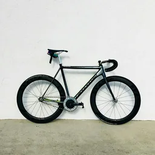</a> <b>#1</b> Black track bicycle against a white wall bicycle · photograph · target (member-normal) · Meets target clarity Alonso Talbert · <a href="https://unsplash.com/license">Unsplash License</a> Visual: approved · rights: approved</td>
<td width="33%" valign="top"><a href="standardized/bicycles/photo-019e1ff4-3acd-7afb-a7c8-dacc74dfb8fd-standardized-v1.webp">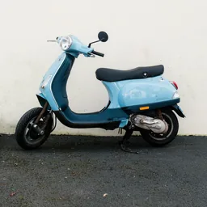</a> <b>#2</b> Blue motor scooter beside a white wall motor-scooter · photograph · distractor (non-member) · Meets target clarity Mathias Reding · <a href="https://www.pexels.com/license/">Pexels License</a> Visual: approved · rights: approved</td>
<td width="33%" valign="top"><a href="standardized/bicycles/photo-unsplash-1505705694340-019e1e335916-standardized-v1.webp">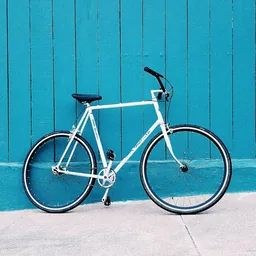</a> <b>#2</b> White road bicycle against a teal wooden wall bicycle · photograph · target (member-normal) · Meets target clarity Carl Nenzen Loven · <a href="https://unsplash.com/license">Unsplash License</a> Visual: approved · rights: approved</td>
</tr>
<tr>
<td width="33%" valign="top"><a href="standardized/bicycles/photo-unsplash-1782851938244-7b632c31bd61-standardized-v1.webp">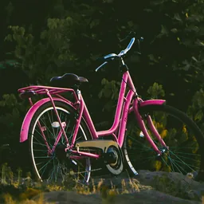</a> <b>#4</b> Pink step-through bicycle before dark foliage bicycle · photograph · target (member-normal) · Meets target clarity Kadir Kvs · <a href="https://unsplash.com/license">Unsplash License</a> Visual: approved · rights: approved</td>
<td width="33%" valign="top"><a href="standardized/bicycles/photo-unsplash-1776905252705-9d5c2fe29c84-standardized-v1.webp">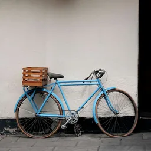</a> <b>#5</b> Light blue bicycle with a wooden crate against a white wall bicycle · photograph · target (member-normal) · Meets target clarity Kris Tian · <a href="https://unsplash.com/license">Unsplash License</a> Visual: approved · rights: approved</td>
<td width="33%" valign="top"><a href="standardized/bicycles/photo-019e1d6c-7703-7a28-ab59-a40afa456fa9-standardized-v1.webp">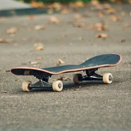</a> <b>#6</b> Skateboard resting on pavement skateboard · photograph · distractor (non-member) · Meets target clarity Pict4life · <a href="https://unsplash.com/license">Unsplash License</a> Visual: approved · rights: approved</td>
</tr>
<tr>
<td width="33%" valign="top"><a href="standardized/bicycles/photo-019e1de1-dd6f-720d-b68e-7471fcfb7757-standardized-v1.webp">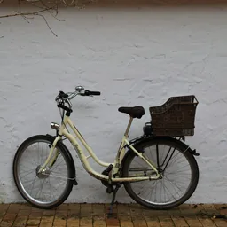</a> <b>#7</b> Cream bicycle with a rear carrier bicycle · photograph · target (member-normal) · Meets target clarity Waldemar Brandt · <a href="https://unsplash.com/license">Unsplash License</a> Visual: approved · rights: approved</td>
<td width="33%" valign="top"><a href="standardized/bicycles/photo-unsplash-1507035895480-2b3156c31fc8-standardized-v1.webp">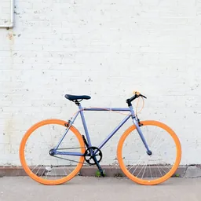</a> <b>#7</b> Lavender bicycle with orange tyres against a white brick wall bicycle · photograph · target (member-normal) · Meets target clarity Tiffany Nutt · <a href="https://unsplash.com/license">Unsplash License</a> Visual: approved · rights: approved</td>
<td width="33%" valign="top"><a href="standardized/bicycles/photo-unsplash-1792271031903-cbf76565581d-standardized-v1.webp">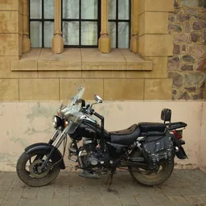</a> <b>#8</b> Black cruiser motorcycle against a stone building motorcycle · photograph · distractor (non-member) · Meets target clarity Iván Antonio · <a href="https://unsplash.com/license">Unsplash License</a> Visual: approved · rights: approved</td>
</tr>
<tr>
<td width="33%" valign="top"><a href="standardized/bicycles/photo-unsplash-1603399301857-4871de8d64d9-standardized-v1.webp">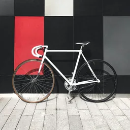</a> <b>#9</b> White road bicycle against black and red facade panels bicycle · photograph · target (member-normal) · Meets target clarity streetwaw_ · <a href="https://unsplash.com/license">Unsplash License</a> Visual: approved · rights: approved</td>
<td width="33%" valign="top"><a href="standardized/bicycles/photo-unsplash-1604946457342-39e980c6050e-standardized-v1.webp">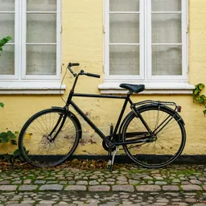</a> <b>#11</b> Black city bicycle against a yellow house bicycle · photograph · target (member-normal) · Meets target clarity Razvan Mirel · <a href="https://unsplash.com/license">Unsplash License</a> Visual: approved · rights: approved</td>
<td width="33%" valign="top"><a href="standardized/bicycles/photo-pexels-4995281-standardized-v1.webp">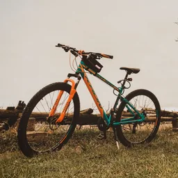</a> <b>#13</b> Orange and teal mountain bike on grass by driftwood bicycle · photograph · target (member-normal) · Meets target clarity Yasin Aydın · <a href="https://www.pexels.com/license/">Pexels License</a> Visual: approved · rights: approved</td>
</tr>
<tr>
<td width="33%" valign="top"><a href="standardized/bicycles/photo-unsplash-1774722396639-a0a6fed00deb-standardized-v1.webp">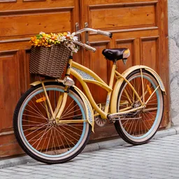</a> <b>#14</b> Yellow cruiser bicycle with a flower basket against a wooden door bicycle · photograph · target (member-normal) · Meets target clarity Mehmet Guzel · <a href="https://unsplash.com/license">Unsplash License</a> Visual: approved · rights: approved</td>
<td width="33%" valign="top"><a href="standardized/bicycles/photo-019e24a0-8170-7687-ad86-d5bce14c1020-standardized-v1.webp">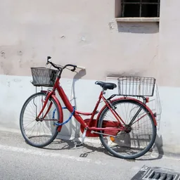</a> <b>#15</b> Red city bicycle against a light wall bicycle · photograph · target (member-normal) · Meets target clarity Valentino Sacco · <a href="https://unsplash.com/license">Unsplash License</a> Visual: approved · rights: approved</td>
<td width="33%" valign="top"><a href="standardized/bicycles/photo-pexels-9078472-standardized-v1.webp">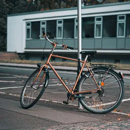</a> <b>#15</b> Copper city bicycle leaning against a street pole bicycle · photograph · target (member-normal) · Meets target clarity Volker Thimm · <a href="https://www.pexels.com/license/">Pexels License</a> Visual: approved · rights: approved</td>
</tr>
<tr>
<td width="33%" valign="top"><a href="standardized/bicycles/photo-unsplash-1698366395517-688b6c1b4d90-standardized-v1.webp">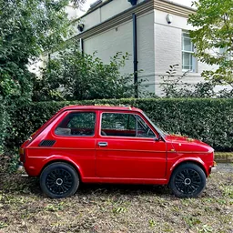</a> <b>#16</b> Small red car parked before a hedge car · photograph · distractor (non-member) · Meets target clarity CrowN · <a href="https://unsplash.com/license">Unsplash License</a> Visual: approved · rights: approved</td>
<td width="33%" valign="top"><a href="standardized/bicycles/photo-unsplash-1778800051130-a7466c7ae19a-standardized-v1.webp">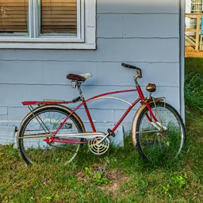</a> <b>#17</b> Red vintage bicycle against a blue clapboard wall bicycle · photograph · target (member-normal) · Meets target clarity Jason Gooljar · <a href="https://unsplash.com/license">Unsplash License</a> Visual: approved · rights: approved</td>
<td width="33%" valign="top"><a href="standardized/bicycles/photo-pexels-10848028-standardized-v1.webp">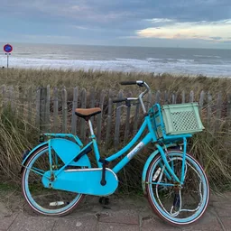</a> <b>#18</b> Turquoise bicycle with a crate against a dune fence bicycle · photograph · target (member-normal) · Meets target clarity Soumia Sol · <a href="https://www.pexels.com/license/">Pexels License</a> Visual: approved · rights: approved</td>
</tr>
<tr>
<td width="33%" valign="top"><a href="standardized/bicycles/photo-unsplash-1698871999765-2fbadbaaae82-standardized-v1.webp">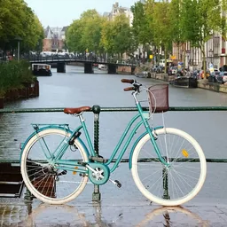</a> <b>#19</b> Teal city bicycle against a canal-bridge railing bicycle · photograph · target (member-normal) · Meets target clarity Dmitrii E. · <a href="https://unsplash.com/license">Unsplash License</a> Visual: approved · rights: approved</td>
<td width="33%" valign="top"><a href="standardized/bicycles/photo-pexels-35826964-standardized-v1.webp">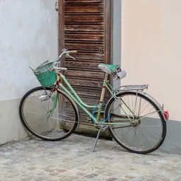</a> <b>#20</b> Pale green bicycle with a basket beside a wooden door bicycle · photograph · target (member-normal) · Meets target clarity Thomas P · <a href="https://www.pexels.com/license/">Pexels License</a> Visual: approved · rights: approved</td>
<td width="33%" valign="top"><a href="standardized/bicycles/photo-unsplash-1631443412966-2a2ab5e18c3b-standardized-v1.webp">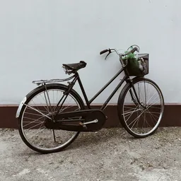</a> <b>#21</b> Black roadster bicycle with a front basket against a white wall bicycle · photograph · target (member-normal) · Meets target clarity Naura Ra · <a href="https://unsplash.com/license">Unsplash License</a> Visual: approved · rights: approved</td>
</tr>
<tr>
<td width="33%" valign="top"><a href="standardized/bicycles/photo-unsplash-1592419044706-39796d40f98c-standardized-v1.webp">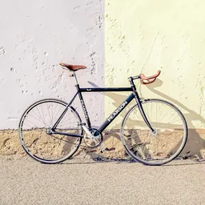</a> <b>#22</b> Navy road bicycle against a two-tone wall bicycle · photograph · target (member-normal) · Meets target clarity Zoltan Tasi · <a href="https://unsplash.com/license">Unsplash License</a> Visual: approved · rights: approved</td>
<td width="33%" valign="top"><a href="standardized/bicycles/photo-unsplash-1667837896876-012372133bbd-standardized-v1.webp">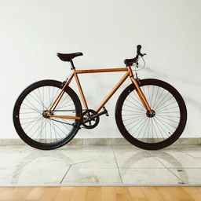</a> <b>#23</b> Copper fixed-gear bicycle against a white wall bicycle · photograph · target (member-normal) · Meets target clarity Markus Spiske · <a href="https://unsplash.com/license">Unsplash License</a> Visual: approved · rights: approved</td>
<td width="33%" valign="top"><a href="standardized/bicycles/photo-unsplash-1777675024325-d93b5c5fc71c-standardized-v1.webp">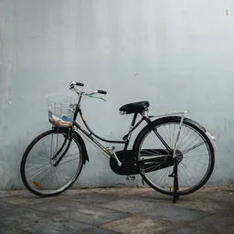</a> <b>#24</b> Black city bicycle with a basket against a grey wall bicycle · photograph · target (member-normal) · Meets target clarity Abhishek Ravi · <a href="https://unsplash.com/license">Unsplash License</a> Visual: approved · rights: approved</td>
</tr>
<tr>
<td width="33%" valign="top"><a href="standardized/bicycles/photo-unsplash-1559348349-86f1f65817fe-standardized-v1.webp">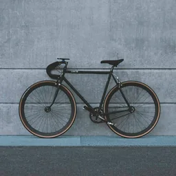</a> <b>#25</b> Black fixed-gear bicycle against a grey concrete wall bicycle · photograph · target (member-normal) · Meets target clarity Howard Bouchevereau · <a href="https://unsplash.com/license">Unsplash License</a> Visual: approved · rights: approved</td>
<td width="33%" valign="top"><a href="standardized/bicycles/photo-flickr-13612564183-standardized-v1.webp">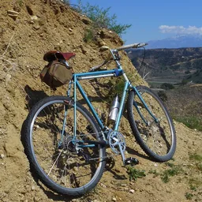</a> <b>#26</b> Light-blue touring bicycle against a dry hillside bicycle · photograph · target (member-normal) · Meets target clarity cyclotourist · <a href="https://creativecommons.org/licenses/by-nc/2.0/">CC BY-NC 2.0</a> Visual: approved · rights: approved</td>
<td width="33%" valign="top"><a href="standardized/bicycles/photo-unsplash-1722872753122-1bd3e86af3e6-standardized-v1.webp">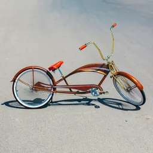</a> <b>#27</b> Copper-orange custom cruiser bicycle on open asphalt bicycle · photograph · target (member-normal) · Meets target clarity Sidral Mundet · <a href="https://unsplash.com/license">Unsplash License</a> Visual: approved · rights: approved 

Unresolved (1)
Custom low-rider cruiser with long swept handlebars and a stretched frame: clearly a bicycle, but a less typical shape; confirm it reads as a normal member rather than a borderline item when composing a set.
</td>
</tr>
<tr>
<td width="33%" valign="top"><a href="standardized/bicycles/photo-unsplash-1676706079694-346cccd54ca4-standardized-v1.webp">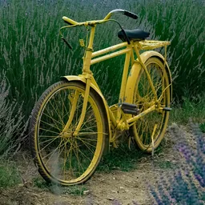</a> <b>#28</b> Yellow roadster bicycle between lavender rows bicycle · photograph · target (member-normal) · Meets target clarity Gunay Topaloglu · <a href="https://unsplash.com/license">Unsplash License</a> Visual: approved · rights: approved 

Unresolved (1)
A few out-of-focus lavender stems at the lower left touch the front tyre; they do not hide any defining part. Reject if the owner reads this as an obstruction.
</td>
<td width="33%" valign="top"><a href="standardized/bicycles/photo-pexels-38644968-standardized-v1.webp">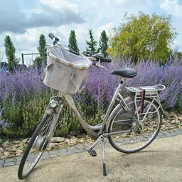</a> <b>#29</b> Silver-beige city bicycle with a basket by a lavender border bicycle · photograph · target (member-normal) · Meets target clarity Teodor Buhl · <a href="https://www.pexels.com/license/">Pexels License</a> Visual: approved · rights: approved 

Unresolved (1)
The front tyre comes within about 1–2% of the lower crop edge because the preview leaves no more room; nothing is cut.
</td>
<td width="33%" valign="top"><a href="standardized/bicycles/photo-unsplash-1602528190586-757f42d99447-standardized-v1.webp">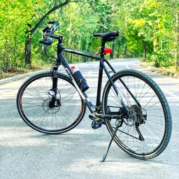</a> <b>#30</b> Black hybrid bicycle on a tree-lined park road bicycle · photograph · target (member-normal) · Meets target clarity Ionut Zamfir · <a href="https://unsplash.com/license">Unsplash License</a> Visual: approved · rights: approved</td>
</tr>
<tr>
<td width="33%" valign="top"><a href="standardized/bicycles/photo-unsplash-1617993200240-9db09bec6b5e-standardized-v1.webp">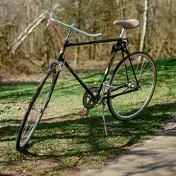</a> <b>#31</b> Black vintage roadster bicycle on a park lawn bicycle · photograph · target (member-normal) · Meets target clarity Alex Plesovskich · <a href="https://unsplash.com/license">Unsplash License</a> Visual: approved · rights: approved 

Unresolved (1)
The dark frame is partly seen against green grass; it remains clear at 128 px because the frame is much darker than the lawn.
</td>
</tr>
</table>

### Manipulated

None yet.

### Final sets

#### G01@1 — legacy-import

“Select all images containing a bicycle.” ([manifest](final/bicycles/G01/1/manifest.json))

<table>
<tr>
<td width="33%" valign="top"><a href="final/bicycles/G01/1/dcd2d84006fe66df.webp">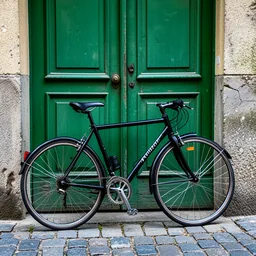</a> <b>G01-T1 ✓</b> A black city bicycle leaning against a green wooden door on a cobbled street bicycle · ai-generated · target (member-normal) · Existing published tile Department of Human Verification · <a href="https://www.gnu.org/licenses/gpl-3.0.html">GPL-3.0-or-later</a> Visual: inherited · rights: inherited 

Unresolved (1)
Historical intermediate files and review timestamps are unavailable; they have not been fabricated.
</td>
<td width="33%" valign="top"><a href="final/bicycles/G01/1/0b9440ab514dced4.webp">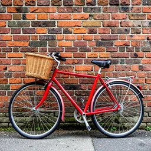</a> <b>G01-T2 ✓</b> A red bicycle with a wicker basket parked against a brick wall bicycle · ai-generated · target (member-normal) · Existing published tile Department of Human Verification · <a href="https://www.gnu.org/licenses/gpl-3.0.html">GPL-3.0-or-later</a> Visual: inherited · rights: inherited 

Unresolved (1)
Historical intermediate files and review timestamps are unavailable; they have not been fabricated.
</td>
<td width="33%" valign="top"><a href="final/bicycles/G01/1/ce37edf2dc0a2731.webp">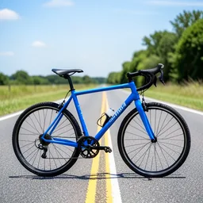</a> <b>G01-T3 ✓</b> A blue road bicycle on an empty country road bicycle · ai-generated · target (member-normal) · Existing published tile Department of Human Verification · <a href="https://www.gnu.org/licenses/gpl-3.0.html">GPL-3.0-or-later</a> Visual: inherited · rights: inherited 

Unresolved (1)
Historical intermediate files and review timestamps are unavailable; they have not been fabricated.
</td>
</tr>
<tr>
<td width="33%" valign="top"><a href="final/bicycles/G01/1/1285019de39d43eb.webp">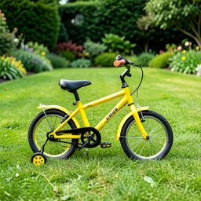</a> <b>G01-T4 ✓</b> A small yellow child's bicycle with training wheels on a lawn bicycle · ai-generated · target (member-normal) · Existing published tile Department of Human Verification · <a href="https://www.gnu.org/licenses/gpl-3.0.html">GPL-3.0-or-later</a> Visual: inherited · rights: inherited 

Unresolved (1)
Historical intermediate files and review timestamps are unavailable; they have not been fabricated.
</td>
<td width="33%" valign="top"><a href="final/bicycles/G01/1/72718790afe43ab8.webp">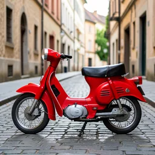</a> <b>G01-T5</b> A red vintage motor scooter parked on a street motor-scooter · ai-generated · distractor (non-member) · Existing published tile Department of Human Verification · <a href="https://www.gnu.org/licenses/gpl-3.0.html">GPL-3.0-or-later</a> Visual: inherited · rights: inherited 

Unresolved (1)
Historical intermediate files and review timestamps are unavailable; they have not been fabricated.
</td>
<td width="33%" valign="top"><a href="final/bicycles/G01/1/9f7aeb69bd32e790.webp">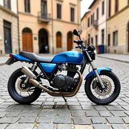</a> <b>G01-T6</b> A blue motorcycle parked on a cobbled square motorcycle · ai-generated · distractor (non-member) · Existing published tile Department of Human Verification · <a href="https://www.gnu.org/licenses/gpl-3.0.html">GPL-3.0-or-later</a> Visual: inherited · rights: inherited 

Unresolved (1)
Historical intermediate files and review timestamps are unavailable; they have not been fabricated.
</td>
</tr>
<tr>
<td width="33%" valign="top"><a href="final/bicycles/G01/1/4e5e0b454064aaf4.webp">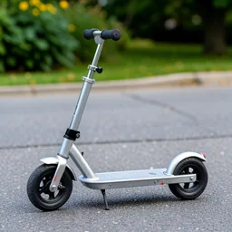</a> <b>G01-T7</b> A child's kick scooter on a pavement kick-scooter · ai-generated · distractor (non-member) · Existing published tile Department of Human Verification · <a href="https://www.gnu.org/licenses/gpl-3.0.html">GPL-3.0-or-later</a> Visual: inherited · rights: inherited 

Unresolved (1)
Historical intermediate files and review timestamps are unavailable; they have not been fabricated.
</td>
<td width="33%" valign="top"><a href="final/bicycles/G01/1/b2bf2dac95c24e8f.webp">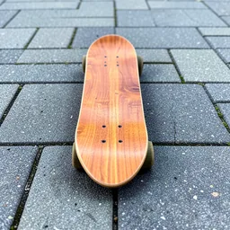</a> <b>G01-T8</b> A skateboard on paving stones skateboard · ai-generated · distractor (non-member) · Existing published tile Department of Human Verification · <a href="https://www.gnu.org/licenses/gpl-3.0.html">GPL-3.0-or-later</a> Visual: inherited · rights: inherited 

Unresolved (1)
Historical intermediate files and review timestamps are unavailable; they have not been fabricated.
</td>
<td width="33%" valign="top"><a href="final/bicycles/G01/1/60c45b81b625a9a4.webp">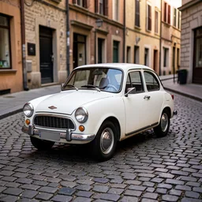</a> <b>G01-T9</b> A small white vintage car parked on a street car · ai-generated · distractor (non-member) · Existing published tile Department of Human Verification · <a href="https://www.gnu.org/licenses/gpl-3.0.html">GPL-3.0-or-later</a> Visual: inherited · rights: inherited 

Unresolved (1)
Historical intermediate files and review timestamps are unavailable; they have not been fabricated.
</td>
</tr>
</table>
